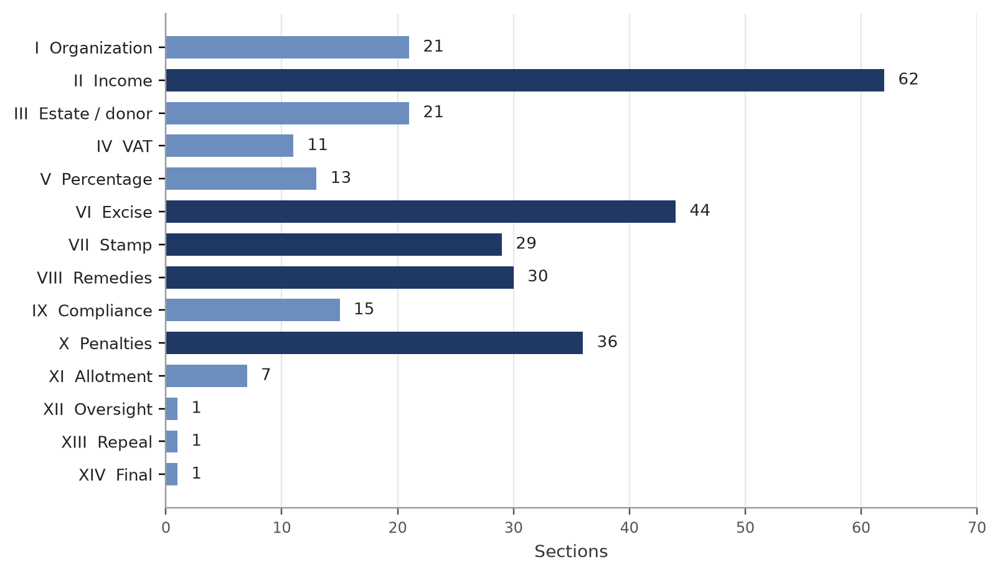

# Formalizing Governance with Lean

## A Four-Day Feasibility Study on the Philippine National Internal Revenue Code

*Formalizability audit, Lean 4 micro-pilot, and a four-day protocol for the NIRC.*

Prepared for: **Aaron Y. Hernandez**, BSANHS Senior Researcher

Adviser: **Oliver R. Francisco**

Date: **15 November 2026**

Execution window: **16–19 November 2026**

Version: **1.0**

<!-- pagebreak -->

# Executive Summary

**The question.** Can a senior researcher mount a credible Lean-based formalization study of Philippine governance rules, starting with the National Internal Revenue Code (NIRC), within four days?

**The answer.** Not a complete formalization. A **rapid formalizability audit of a stratified sample of NIRC sections, paired with a small Lean proof-of-concept on the TRAIN compensation schedule**, is feasible in four working days. It produces an empirical contribution, a reusable codebook, and a technical artifact, while keeping legal risk manageable.

> **Verdict: Conditional GO.** The four-day study is feasible if scope is fixed at 40 sections and one tax schedule, a second reviewer is available for 10 sections, and a CPA or tax practitioner reviews the validation cases. A whole-code formalization is a **NO-GO** for this window.

**Why this is the right first study.** The NIRC is small enough to map: 292 sections in 14 titles, about 85,000 words in the original enactment. It is central to governance, and parts of it are explicitly computational. But it is not a clean dataset: the text is public but not machine-readable or versioned, and much of the operative detail lives in revenue regulations and administrative discretion. The first research question is therefore not "can we prove the tax code?" but "**which parts of the tax code are formalizable, and what does that tell us about automating governance?**"

**What the study delivers.**

- A five-level formalizability codebook for statutory provisions.
- A 40-section stratified sample with descriptive statistics and 95% confidence intervals.
- A public, verified section index of the NIRC.
- A Lean 4 micro-pilot of the 2023-onward TRAIN individual income tax schedule, with proofs of non-negativity and boundary continuity and validation against BIR withholding values.
- An optional cross-reference integrity audit of the sampled sections.
- An 8–12 page paper, dataset, and reproducibility appendix.

**What it does not deliver.** A legally validated tax calculator, a complete NIRC model, a claim that the code contains loopholes, or legal advice. Those are later stages.

**Decision rule.** Proceed on Monday if the corpus, sample, and codebook are ready by 17:00; drop the Lean component if a trivial Lean file does not compile by then; stop and cut scope if the sample or review arrangements expand.

# 1. The Problem and the Opportunity

Governments are automating rules. Tax filing, benefit eligibility, procurement scoring, budget releases, and licensing are increasingly mediated by software. Each automation encodes an interpretation of a legal text. That interpretation is often invisible: it lives in source code, vendor documentation, or an agency's internal configuration. When the law changes, the code is patched; when the code and the law diverge, the divergence is discovered through audits, disputes, or failure.

Formalization inserts a **machine-checked specification** between the legal text and the software. The specification defines the relevant entities, inputs, and computations; theorems state properties that must hold for every input; a proof checker verifies the theorems. The result is not "the law," but a model of the law whose assumptions are explicit and whose consequences are checkable.

Lean 4 is a programming language and proof assistant suited to this task. It has dependent types, a small trusted kernel, and a growing ecosystem. It is not a legal reasoning system, a natural-language interpreter, or a source of legal authority. Its value is that it makes certain claims **true by construction** and others **impossible to hide**.

The research gap is empirical. Advocacy for "rules as code" is abundant; systematic evidence on which Philippine rules are actually formalizable is not. The NIRC is a strategic first case: small, central, computational in parts, and embedded in a larger administrative ecosystem that includes the Bureau of Internal Revenue (BIR), the Department of Finance, the Court of Tax Appeals, and local government units.

# 2. Why It Matters: Value and Significance for Governance Automation

## 2.1 From automating code to verifying rules

Most e-government systems are verified by testing: a set of cases is run, and the outputs are compared with expectations. Testing is necessary but incomplete. It cannot show that a computation is correct for every input, that a threshold is monotone, or that a change in one provision does not break another. Formal verification complements testing by quantifying over all inputs and by making dependencies explicit.

The governance significance is a shift in the **burden of proof**. Today, a citizen who disputes an automated assessment must reverse-engineer the agency's logic. With a formal specification, the logic is inspectable, assumptions are named, and the disputed step can be isolated. This is a trust technology, not just a compliance technology.

## 2.2 Five governance values

**1. Drafting integrity.** Statutes contain cross-references, defined terms, and structural dependencies. A parser can check that every internal reference resolves, that cited provisions exist, and that amendments have conforming changes. The US project found 138 drafting faults across Title 26 using this approach. The Philippine counterpart is a tractable first contribution, especially because the NIRC has 454 cross-reference mentions in its original text.

**2. Verified computation.** A proof can establish that a tax schedule is non-negative, continuous at bracket boundaries, and monotone in income; that a benefit formula does not produce a negative transfer; or that a procurement score cannot exceed its maximum. These are properties that tests can only sample.

**3. Policy simulation and cliff detection.** Governments need to know how a rule behaves at thresholds. A formal model can locate discontinuities, compare regimes (for example, the 8% option versus graduated rates), and prove that a reform does or does not preserve a property such as progressivity or revenue neutrality. The US project found that a one-dollar change in investment income could cost a family its entire earned income credit; the Philippine analogue is the interaction of the 8% option, the ₱250,000 allowance, and the ₱3 million VAT threshold.

**4. Accountability and contestability.** A public, versioned model lets auditors, courts, journalists, and citizens inspect the rule that produced an outcome. Proofs do not settle political questions, but they clarify which questions are empirical, which are interpretive, and which are discretionary. That clarity is itself a democratic good.

**5. Boundary mapping.** Formalization reveals what cannot or should not be formalized: open-textured standards, factual determinations, equitable exceptions, and discretionary authority. A study that maps these boundaries is as valuable as one that proves a theorem. It tells policymakers where human judgment must remain and where automation would be unjust or unlawful.

## 2.3 The Philippine stakes

The BIR is digitizing. The Ease of Paying Taxes Act (RA 11976) modernized registration, invoicing, and filing; the BIR's e-invoicing rules (RMC 98-2026) set a December 2026 deadline for covered taxpayers. Every digital submission depends on a computation or a validation rule. A verified specification could support compliance-by-design, reduce disputes, and make audits more targeted.

Tax disputes often turn on two different questions: what the facts are, and what the law means. A formal model cannot resolve either, but it can separate them. If the arithmetic is proved, the dispute narrows to characterization, valuation, or intent. That is a useful contribution to tax administration.

The same logic applies beyond tax. The New Government Procurement Act (RA 12009) contains pass/fail responsiveness tests and scoring rules. The 4Ps program (RA 11310) contains eligibility conditions and conditionalities. Local government taxation under the Local Government Code is a large, heterogeneous corpus of rate and threshold rules. Each is a candidate for formalization, with different mixtures of computation and discretion.

## 2.4 What formalization does not do

Formalization does not determine facts, resolve ambiguity, establish legislative intent, prove constitutionality, or replace courts. It does not validate its own fidelity: a proof about a wrong encoding is still a proof about a wrong encoding. It does not eliminate discretion; it makes discretion visible. It does not produce legal advice.

## 2.5 The risk side

The risks are real. A verified model can acquire **false legitimacy**: officials and the public may treat a proof as a legal conclusion. The modeler's interpretation can become the default, disadvantaging those without the capacity to contest it. Proofs decay when the law changes; without ownership and maintenance, a verified model becomes a misleading artifact. Formalization can also pressure agencies to automate decisions that should remain individual and contestable.

Mitigations are institutional as much as technical: publish assumptions and limitations, keep a human decision-maker accountable, version the model with the law, require legal review before public claims, and design a contestation channel. The codebook in this study treats "not formalizable" as a finding, not a failure.

# 3. What the US Precedent Actually Shows

The Reddit headline says "Lean proof of the entire US tax code." The underlying project is more precise, and the distinction matters for feasibility.

The project has three components:

1. **Text integrity.** A parser reads every cross-reference in Title 26, including references written in words, and Lean checks whether the cited provision exists and is in force. The suite reports 257 findings, of which 138 are real faults: dead references, typos, wrong subdivision words, duplicate numbering, and unclosed parentheses.
2. **An executable model.** The model covers the 2025 federal individual income tax for a household: income to adjusted gross income, deductions, the tax itself including the alternative minimum tax, and credits. It contains about 2,159 definitions and theorems. It was validated against IRS tables and against three independent tax programs on 5,000 households; it agreed with one reference model on 4,993 of 5,000.
3. **A search for planning strategies.** Using the model as an oracle, the team searched ordinary and multi-year choices. It rediscovered known strategies (filing separately to manage thresholds, Roth conversions, hiring children) and reported three results not found in practitioner sources. The largest single-year cliffs were a few thousand dollars; the large lifetime gains came from strategies already in the literature.

The project's own limits are instructive: coverage is one year and one household type; the AI reviews were not checked by a lawyer or CPA; agreement among calculators is not truth. The code and certificates are public.

A second line of work, Law & Order, formalizes tax forms and instructions rather than the statute alone. Its result is a useful benchmark: the best LLM alone achieved 66% accuracy on held-out returns, while a neuro-symbolic pipeline with cell-level verification and repair reached 100% on 51 held-out returns. The lesson is not that LLMs can formalize law; it is that **verification and repair are what make autoformalization usable**.

Catala offers a complementary design. It is a domain-specific language built for statutory law, with annotations that keep the legal text and the code side by side. Its tax computation for a French family benefit is about 1,500 lines. Catala is more legible to lawyers; Lean offers stronger proof infrastructure and a larger ecosystem for mathematics and verification. A Philippine program should compare the two rather than assume one is universally superior.

**Five lessons for the Philippine study.**

1. Start with text integrity and one bounded computation, not with a monolithic model.
2. Build test vectors with a CPA or tax practitioner; public tables are necessary but not sufficient.
3. Treat AI as a translator and reviewer, not an authority; keep human legal review in the loop.
4. Publish assumptions, coverage, and limits alongside the proofs.
5. Budget for maintenance: a verified model is a build artifact, not a one-time paper.

# 4. The Philippine Corpus: Assets and Constraints

## 4.1 Size and structure

The NIRC of 1997 (RA 8424) has **292 sections in 14 titles**. The original enactment is about **84,800 words** from Title I onward. The sections are distributed as follows.

| Title | Subject | Sections | Share |
|---|---|---:|---:|
| I | Organization and functions of the BIR | 21 | 7.2% |
| II | Tax on income | 62 | 21.2% |
| III | Estate and donor's taxes | 21 | 7.2% |
| IV | Value-added tax | 11 | 3.8% |
| V | Other percentage taxes | 13 | 4.5% |
| VI | Excise tax on certain goods | 44 | 15.1% |
| VII | Documentary stamp tax | 29 | 9.9% |
| VIII | Remedies | 30 | 10.3% |
| IX | Compliance requirements | 15 | 5.1% |
| X | Statutory offenses and penalties | 36 | 12.3% |
| XI | Allotment of internal revenue | 7 | 2.4% |
| XII | Oversight committee | 1 | 0.3% |
| XIII | Repealing provisions | 1 | 0.3% |
| XIV | Final provisions | 1 | 0.3% |
| **Total** | | **292** | **100%** |



*Figure 1. Distribution of the 292 NIRC sections by title. Desk count from the LawPhil RA 8424 text; later amendments do not change the section count, though they change content.*

## 4.2 A corpus profile

A desk count of the original text gives a sense of the formalization challenge:

| Indicator | Count | Interpretation |
|---|---:|---|
| Words (Title I onward) | 84,778 | Small enough for one researcher to read; large enough to require sampling |
| Cross-reference mentions ("Section N" / "Sec. N") | 454 | Dense internal dependencies; a parser must distinguish internal from external references |
| Mentions of "Commissioner" | 353 | Administrative authority is pervasive |
| Mentions of "Secretary of Finance" | 122 | Delegated rulemaking is central |
| Mentions of "rules and regulations" | 142 | Much operative detail is outside the statute |
| "may" | 236 | Lexical proxy for discretion; not a measure |
| "shall" | 1,319 | Mandatory language dominates, but obligations often depend on regulations |

These are lexical proxies, not coded findings. They support a hypothesis, not a conclusion: the NIRC contains a computational core surrounded by a large administrative penumbra. The audit in Section 7 tests that hypothesis.

## 4.3 Assets

- A single national code with stable section numbering.
- English text, reducing translation risk.
- Public access through LawPhil, the BIR, and the Official Gazette.
- Public withholding tables and forms that can serve as validation vectors.
- An active reform record (TRAIN, CREATE, EOPT, CREATE MORE) that makes versioning a real research problem rather than a hypothetical one.
- A manageable size: 292 sections, not thousands.

## 4.4 Constraints

- **No official machine-readable, versioned corpus.** The US has structured XML with release points and a git history; the Philippines has HTML, PDFs, and separate amending statutes. Building the corpus is part of the work.
- **Delegation.** Rates and schedules are in the NIRC, but computation details, valuation rules, and classifications are often in revenue regulations and memoranda.
- **Case law.** Court of Tax Appeals and Supreme Court decisions can change the operative meaning of a provision. A formal model cannot absorb this without a doctrine of precedent.
- **Local taxes.** The Local Government Code creates a separate layer of rates, bases, and ordinances.
- **Incentives.** CREATE and CREATE MORE create special regimes that interact with the general rules.
- **Validation scarcity.** The BIR publishes withholding tables and forms, but fewer worked examples than the IRS. A CPA's review is essential.
- **Skills.** Lean expertise is scarce; the project must budget for learning and review.

The implication is strategic: the first contribution is a **verified corpus and a formalizability map**, not a proof of the whole code. The map tells the next researcher where a proof is worth building.

# 5. Feasibility Assessment

## 5.1 Scorecard

| Dimension | Score (1–5) | Evidence | Implication |
|---|---:|---|---|
| Corpus access | 3 | Public text, but no official machine-readable version; amendments separate | Build and verify an index first |
| Scope control | 4 | 292 sections; section-level sampling is tractable | A 40-section sample is feasible |
| Computational determinacy | 3 | Core rates and schedules are explicit; many details delegated | Expect a large parameterized/discretionary share |
| Validation data | 2 | BIR tables and forms exist; worked examples are limited | Recruit a CPA; use synthetic cases |
| Tooling | 4 | Lean 4 is free; core arithmetic needs no mathlib | Install and smoke-test on Day 1 |
| Skills and time | 2 for full formalization; 4 for audit + micro-pilot | Learning curve is real; the pilot is small | Do the audit first; keep the proof bounded |
| Legal review | 2 | Adviser available; CPA not yet confirmed | Confirm review before claiming validation |
| Ethics and data | 5 | Public documents; no taxpayer data | Low regulatory burden |
| Novelty | 5 | No published formalizability audit of the NIRC found in the sources reviewed | A defensible first contribution |

## 5.2 Overall judgment

**Conditional GO for the four-day study. NO-GO for a whole-code formalization.**

The conditions are:

1. The 292-section index and the 40-section sample are ready by Day 1, 17:00.
2. A second reviewer codes 10 sections; agreement is reported, not assumed.
3. A CPA or tax practitioner reviews the 20 validation cases and the micro-pilot assumptions.
4. Lean compiles a trivial file by Day 1, 17:00; otherwise the Lean component is dropped and the audit proceeds.
5. Scope remains 40 sections and one tax schedule. Any expansion is a new study.

## 5.3 What would change the judgment

- If more than 80% of sampled sections are discretionary or open-textured, a Lean-first program is misdirected; pivot to process mapping and legal-informatic analysis.
- If a CPA cannot validate the micro-pilot, the technical claim is not credible; report the audit only.
- If the consolidated text cannot be stabilized, the audit's construct validity is weak; restrict claims to the original RA 8424 text and say so.
- If the second reviewer is unavailable, the study remains feasible but must be labeled single-coder and exploratory.

# 6. Research Directions

The four-day study is one point in a larger program. The table below compares directions by scope, feasibility, and output.

| Direction | Scope | 4-day feasibility | Output and main risk |
|---|---|---|---|
| **A. Formalizability audit of the NIRC** | 40-section stratified sample; five-level codebook | **High** | Map, dataset, codebook; risk: coding subjectivity |
| **B. Cross-reference integrity audit** | Sampled sections; internal vs external references | **High** | Defect typology and rate; risk: parser ambiguity |
| **C. LLM autoformalization benchmark** | 10–20 provisions; 3 models; Lean or pseudocode | Medium (pilot); 2–4 weeks for full | Accuracy and error taxonomy; risk: API cost, legal review |
| **D. Verified 4Ps eligibility engine** | Household conditions; benefit computation | Low; 3–4 weeks | Verified specification; risk: privacy, local variation |
| **E. Procurement bid evaluation (RA 12009)** | Responsiveness and scoring rules | Low; 4–6 weeks | Verified evaluator; risk: legal interpretation |
| **F. LGU tax ordinance harmonization** | Comparative ordinances; conflicts | Low; 4–8 weeks | Comparative dataset; risk: access, heterogeneity |
| **G. Accountability of law-as-code** | Ownership, contestability, due process | **High** (desk study) | Policy paper; risk: no technical artifact |
| **H. Full NIRC Lean model** | All 292 sections; regulations; case law | **No**; 1–2 person-years | Reference model; risk: fidelity, maintenance |

**Recommendation.** Do **A + the Lean micro-pilot**. Keep **B** as a fallback if Lean fails. Plan **C** as the next study after the audit. Treat **D–F** as a three-to-six-month program once the method is validated. **H** is a team project, not a solo one.

## 6.1 A selection tool: the formalization readiness matrix

Use this matrix to choose the next governance domain.

| | Low discretion | High discretion |
|---|---|---|
| **High cost of error** | Formalize first: rate schedules, eligibility thresholds, benefit amounts, pass/fail procurement tests | Formalize procedure and evidence checks, not the judgment: bid responsiveness, case triage, penalty mitigation |
| **Low cost of error** | Automate and test: reporting formats, routing, calculations with manual override | Do not formalize: discretionary grants, prosecutorial prioritization, constitutional interpretation |

The matrix is a hypothesis, not a law. Its value is that it forces the researcher to ask three questions before writing Lean: How computational is the rule? How costly is an error? How much discretion must remain?

# 7. The Four-Day Study Protocol

## 7.1 Research questions and hypotheses

**RQ1.** What proportion of NIRC sections are directly computable, parameterized, discretionary, or open-textured?

**RQ2.** Can a minimal Lean model of one statutory schedule be proved and validated against official withholding values, and what assumptions does the encoding force?

**RQ3 (optional).** What cross-reference integrity issues appear in the sampled sections?

Hypotheses:

- **H1.** The directly computable share is a minority of sections but is concentrated in Titles II–VII.
- **H2.** A substantial share of sections delegates computation to regulations or discretion, so a NIRC-only model underdetermines outcomes.
- **H3.** The TRAIN compensation schedule can be encoded and validated on 20 official values, but the encoding requires explicit assumptions about what counts as taxable compensation.

These are descriptive and pilot hypotheses. The study is not powered to estimate population proportions precisely.

## 7.2 Design and sample

- **Frame.** 292 NIRC sections, using the consolidated BIR text for coding and the LawPhil RA 8424 text for section structure.
- **Design.** Stratified random sample, proportional to title, with at least one section from each title with five or more sections.
- **Sample size.** 40 sections (13.7%). Double-code 10 (25%) independently.
- **Allocation.** Title II: 8; VI: 6; X: 5; VIII: 4; VII: 4; I: 3; III: 3; IX: 2; V: 2; IV: 1; XI: 1; XII: 1; XIII: 0; XIV: 0. This sums to 40. If a title is excluded by allocation, note it as a limitation.
- **Randomization.** Use a fixed seed; record it. Replace a drawn section only if it is not a rule (for example, a separability clause), and record the replacement.
- **Unit.** The section as enacted. If a section contains multiple distinct rules, code the dominant operative rule and flag "mixed."

## 7.3 Codebook

| Code | Label | Definition | Example |
|---|---|---|---|
| L0 | Not a rule | Title, definition, repeal, separability, organization | Sec. 291 (repealing clause) |
| L1 | Directly computable | Arithmetic, rate, threshold, or table implementable from the text alone | Sec. 24(A) individual rates; Sec. 84 estate tax rate; Sec. 100 VAT rate |
| L2 | Parameterized | Computation is specified but depends on external values, classifications, or regulations | Sec. 34 deductions; Sec. 109 exemptions; valuation rules |
| L3 | Discretionary | Grants authority or requires judgment | Sec. 4 (Commissioner's interpretative power); Sec. 204 compromise |
| L4 | Open-textured | Key terms require case law or doctrinal interpretation | "Tax avoidance," "substance over form," "beneficial owner" |

**Flags.** Cross-reference; delegation to regulations; effective date; penalty; undefined term; mixed rules. **Decision rule.** Code the highest level that applies to the dominant operative computation. When a section mixes levels, code the dominant level and flag the mixture. **Calibration.** Code 10 sections together with the adviser or CPA before coding the rest; revise definitions; record disagreements.

## 7.4 Lean micro-pilot

**Scope.** The 2023-onward TRAIN individual income tax schedule for compensation income. Taxable compensation is an **input**; the pilot does not compute it from gross pay, deductions, or the 13th-month exclusion. Amounts are in centavos to avoid floating point. Rounding is out of scope.

**Model.**

- `bracketTax : Nat → Nat`, with thresholds at ₱250,000, ₱400,000, ₱800,000, ₱2,000,000, and ₱8,000,000.
- Base amounts and marginal rates as enacted by TRAIN.

**Theorems and checks.**

1. Non-negativity: `0 ≤ bracketTax ti` for every taxable income.
2. Boundary continuity: the tax at each threshold equals the base amount of the next bracket.
3. Validation: 20 values from the BIR revised withholding table (or annual schedule) match the model.
4. Stretch: monotonicity for all inputs. If the proof is not completed, report it as an open target, not a result.

**Success criteria.** The file compiles; the five boundary checks pass; 20/20 validation values match; assumptions are documented. A partial result is still useful if the failure is analyzed.

**Why this schedule.** It is explicit, public, and consequential. It is also a gateway to harder questions: the 8% option versus graduated rates, the ₱3 million VAT threshold, the 13th-month exclusion, and the interaction of compensation and business income. Those are the next pilots, not this one.

## 7.5 Optional cross-reference audit

From the 40 sampled sections, extract every "Section N" and "Sec. N" reference. Classify each as internal (to the NIRC) or external (to another law). For internal references, check whether the target exists and whether its subject matches the citing text. Classify as valid, dead, misdirected, or ambiguous. Verify a 20-reference subsample by hand. Report counts and examples, not a claim that the Code is defective.

This is a bounded version of the US project's text-integrity check. It is feasible in a day and adds a second empirical contribution.

## 7.6 Analysis

- **RQ1.** Proportions by code, overall and by title, with 95% Wilson confidence intervals. With n = 40, a proportion near 50% has a confidence interval of roughly ±15 percentage points; report this explicitly.
- **Reliability.** Cohen's kappa on the 10 double-coded sections; report raw agreement and disagreements.
- **RQ2.** Pass/fail on compilation, boundary checks, and 20 validation values; list every mismatch and its cause.
- **RQ3.** Counts by reference class; examples with exact citations.
- **Qualitative log.** Ambiguities, undefined terms, delegation clauses, and coding disagreements, organized by theme.

## 7.7 Day-by-day plan

| Day | Work | Output and decision |
|---|---|---|
| **Mon 16 Nov** | Freeze scope; download LawPhil and BIR texts; build and verify the 292-section index; draw the sample; draft the codebook; install Lean and compile a smoke test | Corpus, sample, codebook, toolchain; **GO/NO-GO at 17:00** |
| **Tue 17 Nov** | Calibrate the codebook on 10 sections with the adviser or CPA; compute kappa; revise; code 30 more; log ambiguities; start the Lean definitions | Calibrated codebook; 40 coded sections; Lean definitions |
| **Wed 18 Nov** | Finish the Lean model; prove non-negativity and five boundary lemmas; validate 20 BIR values; optional 20-reference audit; analysis | Micro-pilot results; cross-reference results; analysis tables |
| **Thu 19 Nov** | Write 8–12 pages; limitations; reproducibility appendix; adviser review; submit | Final paper, dataset, code, and index |

## 7.8 Minimum viable study, stretch, and fallback

- **Minimum viable.** RQ1, the codebook, 40 coded sections, descriptive statistics, and limitations. This is a complete study even without Lean.
- **Stretch.** Add the Lean micro-pilot and the cross-reference audit.
- **Fallback.** If Lean fails, replace the proof-of-concept with a pseudocode specification and a validation table, and keep the audit. Label the result "pre-formalization feasibility," not "formal verification."

# 8. Rigor, Ethics, and Risk

## 8.1 Rigor

- **Construct validity.** The codebook is the instrument. Calibrate it, report disagreements, and preserve the coding manual.
- **Reliability.** Double-code 25%; report kappa. If kappa is low, report the categories that caused disagreement and treat the map as exploratory.
- **External validity.** A 40-section sample is descriptive, not representative of all Philippine governance rules. Say so.
- **Conclusion validity.** Use confidence intervals; avoid causal claims about automation.
- **Legal validity.** Have a CPA or tax practitioner review the micro-pilot's assumptions and the sample coding. A technical proof is not legal validation.
- **Reflexivity.** The researcher's coding decisions are part of the data. Keep a decision log.

## 8.2 Ethics

- Use public documents only; do not use taxpayer data.
- Do not provide tax advice or client-specific calculations.
- Disclose AI assistance, model versions, and prompts in the reproducibility appendix.
- Do not claim agency endorsement or legal authority.
- Frame cross-reference findings as "candidate anomalies requiring verification," not as proven errors.
- If the study identifies a possible drafting defect, give the agency a chance to respond before publication.

## 8.3 Risk register

| Risk | Likelihood / impact | Mitigation |
|---|---|---|
| Lean toolchain fails or learning curve exceeds the window | Medium / high | Smoke test on Day 1; fallback to pseudocode and audit |
| No second coder | Medium / medium | Adviser codes 10 sections; report single-coder limitation |
| CPA unavailable | Medium / high | Use public BIR tables; label the pilot technical, not legal |
| Corpus version drift | High / medium | Freeze the corpus with a date and hash; code the consolidated text; note amendments |
| Coding subjectivity | High / medium | Calibration, codebook, kappa, decision log |
| Scope creep | High / high | Fixed sample and one schedule; any expansion is a new study |
| AI hallucination in translation | Medium / high | Human review; test vectors; no AI-only claims |
| Public claim of a legal defect | Low / high | Legal review; agency response; cautious language |

## 8.4 Limitations to state in the paper

- Small, stratified sample; descriptive estimates with wide intervals.
- Section-level coding loses subsection heterogeneity.
- Original text versus consolidated amendments.
- One tax schedule; not a tax calculator.
- No legal validity claim.
- Single researcher, with limited second-coder review.
- Lean model assumptions are explicit but not legally reviewed unless a CPA participates.

# 9. Expected Contributions and Next Steps

**Empirical.** The first systematic map, to our knowledge, of formalizability in the NIRC: how much is directly computable, how much is parameterized, and how much depends on discretion or interpretation.

**Methodological.** A reusable codebook and coding protocol for statutory formalizability, applicable to procurement, social protection, and local ordinances.

**Technical.** A verified section index, a Lean micro-pilot, and a validation protocol against official values.

**Practical.** Guidance for agencies on where law-as-code is feasible, where it is premature, and where human judgment must remain.

**Publication path.** Start with the school research congress or science fair. Extend to the Philippine Computing Science Congress or a law-and-technology workshop with an adviser co-author. Deposit the dataset and code on Zenodo with a DOI; use CC BY 4.0 for the text and MIT for the code. A full study (292 sections, three-model benchmark, CPA-validated calculator) is a three-to-six-month project, not a four-day one.

# 10. Conclusion

The appeal of the US project is the proof. The research value is the map. Four days are enough to build a credible map of what the Philippine tax code makes computable, to test one small proof, and to identify where the next proof is worth building. That is a feasible, honest, and useful first study in Lean-based governance research.

The larger significance is not that Lean will automate government. It is that formalization can give governance automation something it currently lacks: a public, versioned, machine-checked account of what the rules are, what they assume, and where human judgment remains. The Philippines can start that work with a code small enough to read and important enough to matter.

<!-- pagebreak -->

# References

1. Lexifina, "Formalizing the US tax code," 10 November 2026. https://lexifina.com/blog/formalizing-the-us-tax-code
2. Reddit, "Lean proof of the entire US tax code to find loopholes," r/singularity. https://www.reddit.com/r/singularity/comments/1xt3x96/lean_proof_of_the_entire_us_tax_code_to_find/
3. S. S. Han, Y. Takashima, A. Wei, Z. Li, and M. Genesereth, "Law and Order: Tax Law Autoformalization," arXiv:2610.02792, 2026. https://arxiv.org/abs/2610.02792
4. D. Merigoux et al., "Catala: A Programming Language for the Law," arXiv:2103.03198. https://arxiv.org/pdf/2103.03198
5. OECD, "Cracking the Code: Rulemaking for humans and machines," 2020. https://www.oecd.org/en/publications/cracking-the-code_3afe6ba5-en.html
6. OECD, "Towards a shared reference framework for law as code," 2026 consultation. https://www.oecd.org/en/events/public-consultations/2026/07/consultation-on-the-digital-provision-of-law-towards-a-shared-reference-framework-for-law-as-code.html
7. Republic Act No. 8424, National Internal Revenue Code of 1997, LawPhil. https://lawphil.net/statutes/repacts/ra1997/ra_8424_1997.html
8. Bureau of Internal Revenue, "Tax Code" (consolidated). https://www.bir.gov.ph/tax-code
9. Republic Act No. 10963 (TRAIN), LawPhil. https://www.lawphil.net/statutes/repacts/ra2017/ra_10963_2017.html
10. Republic Act No. 11976 (Ease of Paying Taxes Act), LawPhil. https://www.lawphil.net/statutes/repacts/ra2024/ra_11976_2024.html
11. Republic Act No. 12066 (CREATE MORE), LawPhil. https://www.lawphil.net/statutes/repacts/ra2024/ra_12066_2024.html
12. Republic Act No. 12009 (New Government Procurement Act), LawPhil. https://lawphil.net/statutes/repacts/ra2024/ra_12009_2024.html
13. Republic Act No. 11310 (4Ps Act), LawPhil. https://lawphil.net/statutes/repacts/ra2019/ra_11310_2019.html
14. BIR Revenue Regulations No. 11-2018 and Annex E, Revised Withholding Tax Table. https://bir-cdn.bir.gov.ph/local/pdf/RR%20No.%2011-2018.pdf ; https://bir-cdn.bir.gov.ph/local/pdf/Annex%20E%20RR%2011-2018.pdf
15. BIR Revenue Regulations No. 8-2018 (8% income tax option). https://bir-cdn.bir.gov.ph/local/pdf/Digest%20RR%208-2018_copy.pdf
16. BIR Revenue Memorandum Circular No. 98-2026 (e-invoicing). https://bir-cdn.bir.gov.ph/BIR/pdf/RMC%20No.%2098-2026%20redacted.pdf
17. Lean 4. https://lean-lang.org/ ; Theorem Proving in Lean 4. https://leanprover.github.io/theorem_proving_in_lean4/
18. Department of Finance, "Newly signed Ease of Paying Taxes Act to modernize PH tax administration." https://www.dof.gov.ph/newly-signed-ease-of-paying-taxes-act-to-modernize-ph-tax-administration-and-strengthen-taxpayer-rights/

<!-- pagebreak -->

# Appendix A. Coding Manual

**A.1 Unit of analysis.** A section of the NIRC as enacted. Code the dominant operative rule. If the section contains multiple independent rules, code the dominant one and flag "mixed."

**A.2 Decision sequence.**

1. Is the section a rule at all? If not, L0.
2. Does it specify an arithmetic operation, rate, threshold, or table that can be implemented from the text alone? If yes, L1.
3. If it specifies a computation but depends on external values, classifications, or regulations, L2.
4. If it grants authority or requires judgment, L3.
5. If its key terms require case law or doctrinal interpretation, L4.
6. If multiple levels apply, choose the highest level of the dominant operative rule and flag "mixed."

**A.3 Coding notes.**

- A section that merely defines a term is L0 for the definition, but the definition may make another section L2 or L4. Code the section in which the operative rule appears.
- A section that sets a rate but leaves the base to regulations is L2, not L1.
- A section that says "subject to such rules as the Secretary may prescribe" is at least L2; if the rules determine the substantive outcome, L3.
- A section that uses "reasonable," "substantial," "bona fide," or "in the ordinary course of business" is a candidate for L4.
- Do not infer intent. Code what the text says.

**A.4 Reliability protocol.** Two coders independently code 10 sections. Discuss disagreements; revise the manual only for future sections, and record the revision. Report kappa and raw agreement.

<!-- pagebreak -->

# Appendix B. Corpus Profile and Sampling Allocation

**B.1 Source and date.** LawPhil RA 8424 text for the original structure; BIR consolidated text for coding. Freeze the exact files and hashes on Day 1.

**B.2 Counts.** 292 sections; 14 titles; 84,778 words (Title I onward); 454 cross-reference mentions; 353 "Commissioner"; 122 "Secretary of Finance"; 142 "rules and regulations." These are desk counts, not coded findings.

**B.3 Allocation.**

| Title | Sections | Sample |
|---|---:|---:|
| I | 21 | 3 |
| II | 62 | 8 |
| III | 21 | 3 |
| IV | 11 | 1 |
| V | 13 | 2 |
| VI | 44 | 6 |
| VII | 29 | 4 |
| VIII | 30 | 4 |
| IX | 15 | 2 |
| X | 36 | 5 |
| XI | 7 | 1 |
| XII | 1 | 1 |
| XIII | 1 | 0 |
| XIV | 1 | 0 |
| **Total** | **292** | **40** |

The allocation is proportional with a minimum of one for titles with five or more sections. Titles XIII and XIV are excluded by rounding; note this as a limitation. If the researcher prefers full coverage, add one section each from XIII and XIV and reduce Title II by two; record the choice.

**B.4 Replacement rule.** Replace a drawn section only if it is L0 by inspection (for example, a separability clause) and record the replacement and reason. Do not replace a section because it looks hard.

<!-- pagebreak -->

# Appendix C. Lean Micro-Pilot Skeleton

The following file is a skeleton for the TRAIN compensation schedule. It uses only Lean 4 core and represents amounts in centavos. It was **not compiled in the preparation environment** because Lean was not installed; compiling it is a Day 1 task. If it compiles and the checks pass, it is the technical artifact for the study. If not, use the pseudocode specification and report the failure.

```lean
-- TaxSchedule.lean
-- Micro-pilot: TRAIN individual income tax schedule, 2023 onwards.
-- Amounts are in centavos. Taxable compensation is an input.
-- This is a model, not legal advice.

namespace PHTax

def bracketTax (ti : Nat) : Nat :=
  if ti ≤ 25000000 then 0
  else if ti ≤ 40000000 then (ti - 25000000) * 15 / 100
  else if ti ≤ 80000000 then 2250000 + (ti - 40000000) * 20 / 100
  else if ti ≤ 200000000 then 10250000 + (ti - 80000000) * 25 / 100
  else if ti ≤ 800000000 then 40250000 + (ti - 200000000) * 30 / 100
  else 220250000 + (ti - 800000000) * 35 / 100

theorem bracketTax_nonneg (ti : Nat) : 0 ≤ bracketTax ti :=
  Nat.zero_le _

-- Boundary continuity at the five thresholds.
example : bracketTax 25000000 = 0 := by decide
example : bracketTax 40000000 = 2250000 := by decide
example : bracketTax 80000000 = 10250000 := by decide
example : bracketTax 200000000 = 40250000 := by decide
example : bracketTax 800000000 = 220250000 := by decide

-- Validation vectors (annual schedule; replace with official BIR values).
example : bracketTax 30000000 = 750000 := by decide
example : bracketTax 50000000 = 4250000 := by decide
example : bracketTax 100000000 = 15250000 := by decide
example : bracketTax 250000000 = 55250000 := by decide
example : bracketTax 900000000 = 255250000 := by decide

-- Stretch target, not proved here:
-- theorem bracketTax_mono (a b : Nat) (h : a ≤ b) : bracketTax a ≤ bracketTax b := by
--   ...

end PHTax
```

**C.1 Notes.**

- The schedule is the 2023-onward TRAIN table for individuals. Verify the exact values against the BIR table before publication.
- The model floors centavos. The actual computation may round; rounding is out of scope and must be stated.
- The model does not compute taxable compensation from gross pay, deductions, mandatory contributions, or the 13th-month exclusion. Those are the next extensions.
- `decide` checks concrete equalities by evaluation. It is not a proof of monotonicity.
- If the Lean version or imports differ, adapt the file and record the toolchain version.

<!-- pagebreak -->

# Appendix D. Data Collection Sheet

| Column | Description |
|---|---|
| `section` | NIRC section number |
| `title` | Title number and subject |
| `heading` | Section heading |
| `code` | L0–L4 |
| `flags` | Cross-reference, delegation, effective date, penalty, undefined term, mixed |
| `excerpt` | Short operative text (fair use; keep minimal) |
| `rationale` | One-sentence coding rationale |
| `coder` | Initials |
| `date` | Coding date |
| `notes` | Ambiguities, replacement reason, cross-reference issues |

**D.1 Usage notes.** One row per section; do not merge sections even when rules repeat. Keep excerpts short, because the codebook rather than the excerpt carries the definition. Record the corpus hash and download date once per batch. For every replacement, record the replacement ID and the reason. Never record taxpayer data, client names, or case facts.
