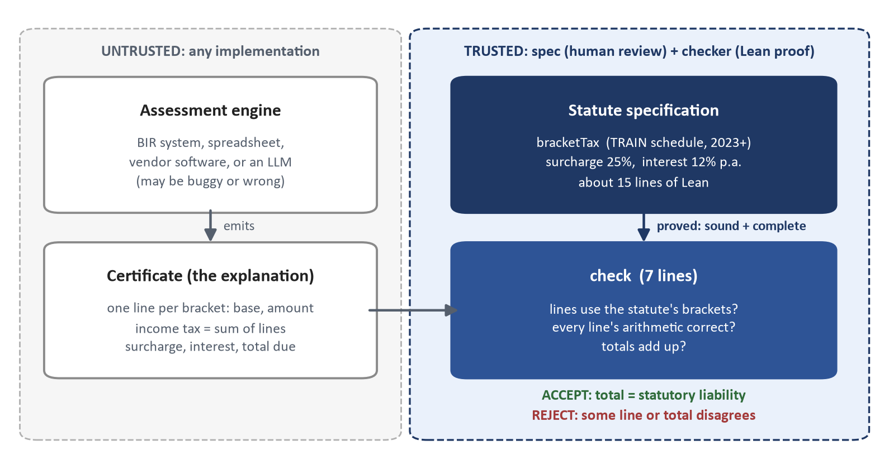
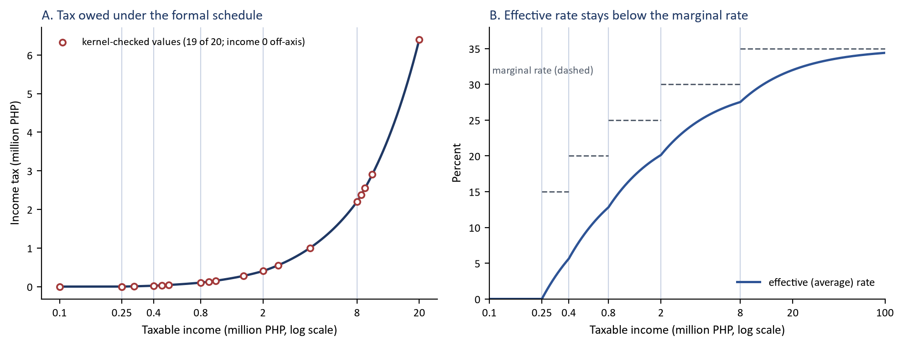

# How Strong Is a Verified Tax Code?

## A Critical Study of Formalizing Philippine Tax Rules in Lean 4, with a Proven Certificate Checker

**Aaron Y. Hernandez**

BSANHS

18 November 2026

> **Abstract.** Governments increasingly compute taxes with software, and soon with large language models (LLMs), but citizens cannot check how a number was produced. We ask whether a small, machine-checked core of Philippine tax law can make such computations auditable, and how strong this idea is against the literature. We formalize the TRAIN individual income tax schedule, the late-payment surcharge and interest, the VAT registration threshold, the RA 11976 taxpayer tiers, and the 8% optional regime for purely self-employed taxpayers in Lean 4, and build a certificate checker: any engine, trusted or not, can submit a line-by-line explanation of an assessment, and a seven-line checker accepts it only if every line follows the statute. We prove the checker *sound* (an accepted certificate states the statutory liability) and *complete* (the honest certificate is always accepted). The artifact contains 59 theorems and 82 kernel-checked examples with no unproven steps. Mutation tests show that removing the statute guard, the tier guard, the 8% rate, or the election eligibility guard breaks the proofs. For the 8% election, the certificate must justify the regime choice itself: an ineligible election is rejected even when every amount is recomputed consistently. We then subject both checkers to untrusted engines: across two studies, sixteen engines — thirteen seeded-fault implementations and three LLM sessions computing by hand — submit 766 certificates judged only by the verified checkers. An automated battery renders 274 further propositions — 128 equivalence witnesses, 56 divergence counterexamples, and 90 boundary, incentive, identity and gap findings — each checked by the same kernel at `propext`. No faulty engine ever produced an accepted wrong total; the subtlest faults are a misreading of the ₱3,000,000 tier boundary that passes 30 of 32 cases, and regime-conditional faults that hide on 55 of 64 election cases because the 8% branch runs only on nine of them. Finally, we turn the verified core on itself and derive five loophole findings — missing input guards and statutory arbitrage — each demonstrated by kernel-checked examples, including an income crossover at which the 8% election turns from a penalty shelter into a penalty trap. The study also criticizes itself. The most serious risk, a correctly verified but legally wrong specification, appeared in our own model, which omitted the reduced penalties that RA 11976 grants micro and small taxpayers; we repaired the specification with new proofs and the flaw remains as a lesson: the repaired specification still awaits review by a tax practitioner.

**Keywords:** formal verification, Lean 4, rules as code, certifying algorithms, tax law, Philippines, large language models

<!-- pagebreak -->

## 1. Introduction

A tax assessment is a number with consequences. When the Bureau of Internal Revenue (BIR) tells a taxpayer that they owe ₱53,544.17, the taxpayer has a right to know where that number came from. Today that number is produced by software. Tomorrow it may be produced, or at least drafted, by a large language model. Both can be wrong, and neither explains itself in a form a citizen can check.

Formal verification offers a different kind of trust. A proof assistant such as Lean 4 [9] lets us state a property, for example that "the tax never decreases when income increases", and have a small, well-tested kernel check every step of the proof. This idea recently drew public attention through a self-reported Lean formalization of most of the United States Internal Revenue Code [17]. It is natural to ask whether the same can be done for the Philippine National Internal Revenue Code (NIRC) [37], and whether it is worth doing.

This paper answers that question in two parts. The **constructive part** builds a small, fully proven artifact. It formalizes a computational core of the NIRC — the income-tax schedule, penalties, the VAT threshold, taxpayer tiers and the 8% election — and adds a *certificate checker* that can audit assessments produced by any untrusted engine. The **critical part** asks how strong the idea really is. It reviews 48 sources across computational law, formal methods, LLMs and law, and the documented failures of automated government, then scores the idea on an explicit rubric.

**The short answer.** The broad idea, "put the tax code in a theorem prover", is not new and is not a winning idea by novelty alone. France already uses verified-style tax code in production [16], [28], [29]. The narrower idea is fresher and defensible: a *proven checker* that makes untrusted, possibly LLM-generated Philippine tax assessments auditable. Its biggest weakness is not the mathematics but the specification. A proof only shows that the code matches *our reading* of the law, and our own reading turned out to be incomplete (Section 6.1); the repair, with new proofs and measured engine studies against both checkers, is Sections 5.6–5.9, and Section 5.10 turns the verified core on itself to derive loophole findings.

**Contributions.**

1. To our knowledge, the first Lean 4 formalization of a Philippine statute: the TRAIN schedule, the penalty rules, the VAT threshold, the RA 11976 taxpayer tiers and the 8% optional regime, with 59 theorems and 82 kernel-checked examples, without `sorry`.
2. A certificate checker for tax assessments, with machine-checked soundness and completeness theorems and mutation tests showing that its key guards — statute, tier, and election eligibility — are necessary.
3. A verified *repair* of our own specification: after finding that the model omitted the RA 11976 tier concessions, we rebuilt it around the taxpayer tiers, proved the repair conservative for medium and large taxpayers, and proved a boundary theorem about the ₱3,000,000 reading.
4. Reproducible Philippine benchmarks (32 cases for the tiered checker, 64 truth rows for the election-aware checker) with ground truth agreed by two independent implementations, and measured studies of sixteen untrusted engines — thirteen seeded faults and three LLM sessions computing by hand — through the verified checkers, 766 certificates with no false accepts.
5. A critical assessment with explicit research parameters, a confidence-rated literature synthesis, a scoring rubric, an implementation plan with status, and a legal-review packet ready for a practitioner.
6. Five loophole findings derived from the verified core itself rather than from the literature — missing realism, election-timing and prescription guards, a single penalty cliff at ₱20,000,000, and an income crossover where the 8% election turns from penalty shelter into penalty trap — each demonstrated by kernel-checked statements and an independent Python cross-check.

**Paper organization.** Section 2 sets out the research design; Section 3 gives the background and related work; Section 4 presents the verified core; Section 5 reports the results; Section 6 delivers the critical assessment; Section 7 asks how strong the idea is; Section 8 states the limitations and threats to validity; Section 9 covers reproducibility and implementation status; Section 10 concludes. Appendix A maps the artifact and the commands that reproduce it.

## 2. Research Design

### 2.1 Research questions

<!-- widths: 0.12, 0.58, 0.30 -->

| RQ | Question | Answered in |
|---|---|---|
| RQ1 | Which kinds of NIRC rules can be formalized, and at what cost? | Sections 3.6, 4, 6 |
| RQ2 | Can a small Lean 4 core prove useful properties of real NIRC rules? | Sections 4.1–4.2, 5 |
| RQ3 | Can a certificate checker make untrusted engines auditable, with proven soundness and completeness? | Sections 4.3–4.5, 5 |
| RQ4 | How strong is the idea relative to existing work: novelty, rigor, significance, feasibility? | Sections 6–7 |
| RQ5 | What fault classes does the checker actually catch, at what rate? | Sections 5.6–5.9 |
| RQ6 | What gaps and incentives does the verified core itself expose? | Section 5.10 |

### 2.2 Scope

**In scope.**

- The TRAIN individual income tax schedule for 2023 onward (NIRC Sec. 24(A)(2), as amended by RA 10963 [38]).
- The 25% surcharge on late payment (Sec. 248(A)) and its 10% reduced form for micro and small taxpayers (RA 11976 Sec. 45(b) [39]).
- Deficiency interest at 12% per year (Sec. 249, as amended by TRAIN) and its 6% reduced form (RA 11976 Sec. 45(c)).
- The ₱3,000,000 VAT exemption and registration threshold (Sec. 109(CC) and Sec. 236, as amended by RA 11976).
- The taxpayer tier classification by gross sales (RA 11976 Sec. 3, amending NIRC Sec. 21(b)): micro, small, medium, large.
- The 8% optional income tax for purely self-employed individuals and professionals (NIRC Sec. 24(A)(2)(b), introduced by RA 10963 Sec. 5 [38]; election mechanics per BIR RR 8-2018 [48]), and the Sec. 116 percentage tax (3% of gross sales) that it replaces.

**Out of scope.**

- Deductions and corporate income tax; mixed-income earners, VAT-registered persons and GPP partners under the 8% option; the quarterly timing and credit mechanics of the election.
- The CPI indexing of the VAT threshold, the reduced compromise penalties and information-return penalties of RR 6-2024 (whose main rates we verified verbatim; the compromise schedules are not formalized), criminal penalties, and deadline calendars.
- Revenue regulations' fine detail, case law, and the factual question of what a taxpayer's taxable income actually is.

### 2.3 Modelling conventions

- All amounts are in **centavos**, stored as natural numbers.
- Each bracket's tax is computed with floor division, and so is interest.
- Interest uses a 365-day year on the basic tax.

These are modelling assumptions, not statements of BIR practice, and Section 6 discusses their effect.

### 2.4 Hypotheses and metrics

We stated three expectations before building the artifact, so that the results could contradict them.

- **H1.** Useful properties of these rules can be proven in Lean 4 core, without the Mathlib library [26], in days rather than months.
- **H2.** A checker for line-by-line tax certificates can be proven sound and complete.
- **H3.** Verification alone will *not* detect errors in which the specification itself misreads the law.

We report the following metrics:

- the number of theorems and kernel-checked examples;
- the number of unproven steps (`sorry`);
- the axioms each main theorem depends on;
- the outcome of a mutation test;
- build time;
- the size of the trusted base;
- statutory coverage, measured as a share of the NIRC's 292 sections (about 84,800 words) in our section index;
- benchmark and engine metrics: acceptance and rejection rates per engine, errors among accepted certificates (predicted to be zero by soundness), and the largest overclaim among rejected ones.

### 2.5 Method for the critical review

- **Search.** Sources were collected by web search across six areas: rules as code; tax-law formalization; verification and certifying algorithms; LLMs and law; failures of automated government; and the Philippine context. We searched deliberately for critical and opposing views in each area.
- **Pinning.** Every DOI (27 in all) was resolved against Crossref. Statutes, reports and judgments were taken from official sites.
- **Tiers.** Each source was tiered: T1 is peer-reviewed, official or judicial; T2 is an institutional publication or a preprint from an identifiable group; T3 is self-reported.
- **Confidence.** Claims are rated High, Medium or Low by the number and tier of independent sources.
- **Limitation.** Retrieval was done sequentially by one agent, without an independent verification pass.

The full research notes, with source extracts, accompany this paper.

### 2.6 Evaluation protocol

The two engine studies of Sections 5.7 and 5.9 share one protocol. Benchmarks are generated independently of the checker: ground truth is computed twice, by an independent Python transcription of the rules and by the verified Lean definitions, and the build fails unless every row agrees — 32 tiered cases, and the same 32 cases crossed with the election flag (false, true) for 64 election rows. Each untrusted engine then emits a complete certificate for every row, 254 certificates in the tiered study and 512 in the election study, and only the verified checkers (`checkT` and `check8`) judge them. Acceptance requires every line of the certificate to follow the specification; how the engine arrived at the certificate is not consulted. Because the checkers are proven sound, errors among accepted certificates are predicted to be zero, so the studies test that prediction rather than assume it.

The engines are of two kinds: programmatic implementations carrying seeded faults, and LLM sessions producing assessments by hand. The resulting rates describe those engines on this benchmark. They are a descriptive measurement, not a representative sample of deployed tax software or of LLMs in general.

## 3. Background and Related Work

### 3.1 Rules as code

Writing law as a program is an old idea. In 1986, Sergot and colleagues encoded the British Nationality Act as a logic program and found that the exercise exposed ambiguities in the drafting [42]. The field of AI and law has since grown a large literature [2].

The modern policy movement, usually called *rules as code*, argues that governments should publish official machine-consumable versions of rules alongside the legal text [30], [44]. Examples include New Zealand's cross-agency Better Rules discovery [34] and OpenFisca, an open tax-and-benefit engine first developed for the French government [35]. Lawsky has argued that tax statutes have a precise logical structure that formal logic can capture [21]. She has also described how to formalize the US Code [22] and evaluated Catala as a route to computationally accessible tax law [23].

**Assessment.** Encoding tax rules is mainstream in policy circles. Most government deployments, however, are calculators and pilots rather than proofs. [Medium-High]

### 3.2 Formalizing tax law

**Catala.** The most mature effort is Catala, a programming language designed so that each block of code mirrors a paragraph of statute, with a formal semantics [28]. Its authors reported finding a bug in an official French implementation. Huttner and Merigoux place Catala in the long line of legal expert systems [15]. Monat, Fromherz and Merigoux formalized date arithmetic in law and statically detected ambiguities in it [31].

**France's tax engine.** The French tax administration's own computation language was given a modern, verified-style compiler [29]. Inria reports that Catala is used at the tax and family-benefits agencies [16].

**Lean 4 and the US Code.** At the other extreme is the AI-assisted Lean 4 formalization of the US Internal Revenue Code. It self-reports 765 sections, about 537,400 lines, 607 theorems and 17 unproven steps [17]. It is not peer-reviewed or independently audited.

**Assessment.** Faithful formalization of computational tax law finds real bugs, and it is in production in France. [High] Mass AI-assisted formalization in Lean exists, but its quality is self-reported. [Medium]

### 3.3 Formal verification and certifying algorithms

Lean 4 is both a programming language and a theorem prover with a small trusted kernel [9]. Landmark projects such as the seL4 operating-system kernel [19] and the CompCert C compiler [24] show that full correctness proofs of real software are possible but expensive.

A cheaper idea runs through proof-carrying code [33], programs that check their work [4] and *certifying algorithms* [27]. Let an untrusted program produce its answer together with a *witness*, and trust only a small checker that validates the witness. If the checker is proven correct, a wrong answer can never be accepted, however the answer was produced. The trusted part of the system shrinks from "the whole engine" to "the checker and its specification".

**Assessment.** This is the idea we apply to tax assessments. It is well established in computer science [High]. We found it rarely applied to tax explanations; the closest work is Han et al. [11].

### 3.4 LLMs and tax law

LLMs struggle with statutes:

- **SARA** introduced a benchmark of statutory reasoning in tax law [14]. GPT-3 proved unreliable on its simple synthetic statutes [3].
- **Nay et al.** observed tax-law ability emerging with model scale, but below expert level [32].
- **LegalBench** organizes legal reasoning into 162 tasks [10].
- **Hallucination.** General models frequently hallucinate legal facts [8], and leading commercial legal research tools still hallucinate on a substantial share of queries [25].

The most direct evidence comes from tax returns:

- **TaxCalcBench.** Frontier models alone computed fewer than one-third of US federal returns correctly [5].
- **Law&Order.** Han et al. report a neuro-symbolic pipeline in which an LLM drafts formal rules that are checked and repaired symbolically. It reached 100% accuracy on 51 held-out returns, against 66% for the best LLM alone [11].
- **Autoformalization.** LLMs can translate a meaningful fraction of informal mathematics into formal statements [45], which suggests the same may hold for law.

**Assessment.** LLMs alone are unreliable at tax computation. [High] Pairing them with symbolic checking can close the gap. [Medium; one preprint]

### 3.5 When automated government fails

The strongest argument for checkable tax software comes from its failures. The strongest argument *against* overselling verification comes from the same cases (Table 1).

*Table 1. Documented failures of automated government and what verification could have done.*

<!-- widths: 0.24, 0.38, 0.38 -->

| Case | What went wrong | Would a proof have helped? |
|---|---|---|
| Robodebt, Australia (Royal Commission, 2023) [41] | Debts raised by income averaging, a method found to be unlawful | No. A proof would faithfully verify an unlawful rule. |
| Toeslagenaffaire, Netherlands (2020) [36] | Rule-of-law principles violated in childcare-benefit recovery | No. The failures were in policy, process and contestability. |
| MiDAS, Michigan (*Cahoo*, 6th Cir. 2019) [6] | Automated fraud findings; a review of about 22,000 found 93% involved no fraud | Partly. A checkable trail aids contestation. |
| Horizon, UK (*Bates (No 6)*, 2019) [1] | Software bugs produced shortfalls blamed on sub-postmasters | Yes. This is the implementation-bug class that certificates target. |

The scholarly critique is consistent:

- Citron argued that automation erodes notice and hearing, and called for "technological due process" [7].
- Kroll and colleagues argued for technical tools of accountability, not mere transparency [20].
- Hildebrandt warned that code-driven law "freezes the future and scales the past" [13].
- Kennedy asked how courts can review administration by software [18].
- Smith, Godfrey and Burdon recast rules as code through legal design patterns [43].
- Underneath all of these sits Hart's observation that legal terms have an *open texture* that no rulebook can fix in advance [12].

**Assessment.** The largest public harms came from wrong rules and weak contestability, not from arithmetic bugs. [High] Verification addresses one important failure class, not all of them.

### 3.6 The Philippine context

The NIRC (RA 8424) [37] was substantially amended by TRAIN (RA 10963) [38], which set the current income tax schedule and deficiency interest at twice the legal rate.

The Ease of Paying Taxes Act (RA 11976) [39]:

- classified taxpayers as micro (gross sales under ₱3M), small, medium and large;
- fixed the ₱3M VAT threshold, adjusted for inflation every three years;
- mandated the digitalization of BIR processes;
- granted micro and small taxpayers reduced penalties.

The E-Governance Act (RA 12254) [40] mandates digital public services more broadly.

Philippine law therefore now *requires* digital tax administration, but says little about how to make that software trustworthy. In our searches we found no prior Philippine rules-as-code or theorem-prover work on the NIRC. Because this is absence of evidence, we rate it [Low].

*Table 2. Comparison with related tax-formalization efforts.*

<!-- widths: 0.18, 0.44, 0.20, 0.18 -->

| Work (source) | What it does and what is verified | Scale | Independent review |
|---|---|---|---|
| OpenFisca [35] | Open tax-and-benefit calculators, first developed for the French government; code, not proofs | Multi-country tax and benefit rules | Not reported |
| Catala and the French tax engine [16], [28], [29] | A rules language whose blocks mirror statute paragraphs, with a formal semantics; the compiler and its semantics are verified, and it found a bug in an official implementation | Production use at the French tax and family-benefits agencies | Reported by its authors and Inria |
| US Internal Revenue Code in Lean 4 [17] | AI-assisted mass formalization; status self-reported, with 17 unproven steps | 765 sections, about 537,400 lines, 607 theorems | None: not peer-reviewed or independently audited |
| Han et al. [11] | An LLM drafts formal rules, checked and repaired symbolically; form accuracy, with equivalence and divergence proofs (Section 5.11) | 51 held-out returns; 100% accuracy reported, against 66% for the best LLM alone | Preprint, not peer-reviewed |
| This work | Lean 4 core with certificate checkers; soundness and completeness proved, guards mutation-tested, every generated finding axiom-audited | Five modelled rules plus the 8% regime; 59 theorems, 82 examples, 766 certificates | Practitioner review pending |

Table 2 summarizes the comparison; the assessments in the subsections above carry the confidence tiers.

## 4. The Verified Core

The artifact consists of seven Lean files totalling 1,024 lines, using only Lean's core library.

### 4.1 The income tax schedule

The TRAIN schedule taxes each slice of income at its own marginal rate. The key definition is a *slice*: the part of income `t` that falls between a lower bound `lo` and an upper bound `hi`.

```
def slice (t lo hi : Nat) : Nat := min (t - lo) (hi - lo)

def bracketTax (t : Nat) : Nat :=
  slice t 25000000 40000000 * 15 / 100      -- P250k to P400k at 15%
  + slice t 40000000 80000000 * 20 / 100    -- P400k to P800k at 20%
  + slice t 80000000 200000000 * 25 / 100   -- P800k to P2M at 25%
  + slice t 200000000 800000000 * 30 / 100  -- P2M to P8M at 30%
  + (t - 800000000) * 35 / 100              -- above P8M at 35%
```

One mathematical detail does real work here. On natural numbers, Lean's subtraction is *truncated*: `t - lo` is 0 whenever `t < lo`. So a slice is automatically 0 below its bracket and capped at the bracket's width above it, with no case analysis.

We proved that `bracketTax` is **monotone**: if a ≤ b then `bracketTax a ≤ bracketTax b`. In plain words, earning more never lowers your tax. The proof composes four small lemmas: slices are monotone, multiplying by a rate preserves order, floor division preserves order, and sums of monotone terms are monotone.

We also checked 20 values with Lean's `decide`. With `decide`, the kernel itself evaluates the definition, rather than compiled code.

- **Boundary values.** At each of the five thresholds, our definition reproduces the fixed amounts printed in the statute: ₱0, ₱22,500, ₱102,500, ₱402,500 and ₱2,202,500.
- **Interior values.** Fifteen further values lie across all six brackets.

Figure 2 plots the schedule with these checked points.

### 4.2 Penalties, VAT and the total due

The surcharge is 25% of the tax. Interest is 12% per year, computed per day. The penalty is their sum, and the total due is the tax plus the penalty. We proved ten properties of these rules:

- penalties are zero when the tax is zero;
- interest and the penalty never decrease as days of delay increase;
- the surcharge never exceeds the full penalty;
- the total due is never less than the tax.

For VAT, we defined exemption (gross sales ≤ ₱3,000,000) and the registration duty (sales above it). We proved the two exact complements: a taxpayer is exempt *if and only if* they are not required to register. We also proved that exemption is downward-closed: if a seller with higher sales is exempt, so is one with lower sales.

### 4.3 The certificate checker

The central construction is a **certificate**: a structured explanation that any engine can produce. It records:

- the income and days late;
- one line per bracket, giving the bracket, the portion of income inside it, and the tax on that portion;
- the income tax, surcharge, interest and total.

The checker is seven lines long.

```
def check (c : Cert) : Bool :=
  c.lines.map Line.br == statute                      -- the statute's brackets
  && allOK c.income c.lines                           -- each line's arithmetic
  && c.incomeTax == sumAmounts c.lines                -- lines add up
  && c.surcharge == surcharge c.incomeTax             -- 25% surcharge
  && c.interest == interest c.incomeTax c.daysLate    -- 12% interest
  && c.total == c.incomeTax + c.surcharge + c.interest
```

We proved two theorems about it.

```
theorem check_sound {c : Cert} (h : check c = true) :
    c.total = totalDue (bracketTax c.income) c.daysLate

theorem check_complete (t days : Nat) :
    check (mkCert t days) = true
```

**Soundness** says that if the checker accepts a certificate, its total *equals* the total due under the statute's schedule and penalty rules. It does not matter who produced the certificate or how. **Completeness** says that the honest certificate, built by `mkCert` for any income and any delay, is always accepted. So the checker never wrongly rejects a correct assessment.

A further theorem, `check_mono`, shows that accepted certificates inherit the monotonicity of Section 4.1. The soundness proof rests on the lemma `sumTax_statute`, which shows that the checker's bracket table computes exactly `bracketTax`. As a result, the bracket table itself does not need to be trusted separately.



*Figure 1. The certificate architecture. Any engine may produce a certificate; only the specification and the proven checker are trusted. The specification still needs human legal review: a proof cannot show that it matches the law.*

### 4.4 The tiered checker: repairing the specification

The first version of the model applied the 25% surcharge and 12% interest to every taxpayer. As Section 6.1 explains, that reading is incomplete: RA 11976 classifies taxpayers by gross sales and grants micro and small taxpayers reduced civil penalties. Rather than patch the flaw quietly, we repaired the specification in a fifth file, `Tiers.lean` (207 lines), with the new obligations made explicit:

- **Classification** (`classify`): micro is *under* ₱3,000,000 gross sales, small is ₱3,000,000 up to ₱20,000,000, medium up to ₱1,000,000,000, large above, following RA 11976 Sec. 21(b) verbatim (Section 5.6 verifies the source).
- **Tiered rates** (`surchargeT`, `interestT`): 10% and 6% for micro and small; 25% and 12% otherwise.
- **A tiered certificate** (`CertT`): the engine must now state gross sales and the tier it claims. The checker recomputes the classification and compares — a taxpayer cannot silently claim a cheaper tier.
- **The tiered checker** (`checkT`): seven lines as before, plus the tier guard.

The new theorems mirror the old ones. `checkT_sound` says an accepted certificate states `totalDueT (classify c.grossSales) ...` — the liability under the *correct* tier, not the claimed one. `checkT_complete` says the honest tiered certificate is always accepted. Three theorems constrain the repair itself: for medium and large taxpayers the tiered total *equals* the old `totalDue` (the repair is conservative); no tier pays more than the untiered model; and classification is monotone in gross sales.

One theorem is purely about the law's text. RA 11976 makes micro *less than* ₱3,000,000 (Sec. 21(b)) but VAT exemption *at most* ₱3,000,000 (Sec. 109(CC)). `vat_tier_gap` proves that exactly one value of gross sales — ₱3,000,000 itself — is VAT-exempt yet not micro. Nothing in the mathematics forces this; it is an artifact of two statutes using different comparisons, and the checker now polices it.

A tier-forgery example shows the guard working: a large taxpayer who recomputes *all* penalties consistently under a claimed micro tier — a self-consistent certificate — is still rejected, because the claimed tier disagrees with the stated gross sales. The mutation test confirms necessity: deleting the tier guard breaks three proofs, and the forged certificate is then accepted.

### 4.5 The 8% election: a rule where checking is cheap

The roadmap's third step asked for a rule where the certificate must justify a *choice*, not just an arithmetic sum. The 8% optional income tax is exactly such a rule. NIRC Sec. 24(A)(2)(b), introduced by RA 10963 Sec. 5 and left untouched by RA 11976, allows purely self-employed individuals and professionals whose gross sales/receipts and other non-operating income "does not exceed" the VAT threshold to elect "an eight percent (8%) tax on gross sales or gross receipts and other non-operating income in excess of Two hundred fifty thousand pesos (P250,000) in lieu of the graduated income tax rates ... and the percentage tax under Section 116" [38]. BIR RR 8-2018 supplies the election mechanics: the election is signified in the first-quarter return, is irrevocable for the year, defaults to graduated rates when absent, and reverts to graduated rates automatically if the annual gross exceeds the threshold [48]. The graduated branch therefore includes the Sec. 116 percentage tax — 3% of gross sales in the EOPT text [39] — which the 8% branch replaces.

We model this in a sixth file, `Opt8.lean` (296 lines). The regime is decided by a two-condition guard:

```
def regimeOf (elected : Bool) (gs : Nat) : Regime :=
  if elected && eligible8 gs then .eight else .graduated
```

where `eligible8 gs` is `gs ≤ vatThreshold`. The eligibility boundary is the VAT comparison (≤), not the micro-tier comparison (<): exactly ₱3,000,000 qualifies for the election but is *not* micro — the same two-statute gap that `vat_tier_gap` exposes in Section 4.4, now load-bearing in a second rule.

The election-aware certificate (`Cert8`) adds an election flag and a claimed regime to the tiered certificate. The checker (`check8`) first verifies the claimed regime against `regimeOf`, then checks the regime's own arithmetic: under graduated rates, the bracket lines must match the statute and the basic tax is the bracket sum *plus* the percentage tax; under the 8% option, there are no bracket lines and the basic tax is 8% of gross in excess of ₱250,000. Penalties then apply to the basic tax under the correct tier, as in Section 4.4.

Sixteen theorems cover the extension. The headline results:

- **`check8_sound` / `check8_complete`**: an accepted certificate's total equals the liability under the *correct* regime for the stated election and gross sales; the honest certificate is always accepted.
- **`claimEight_rejected`**: an ineligible election is rejected even when every amount is recomputed consistently under the claimed regime — the election analogue of the tier forgery. The certificate must justify the choice, not merely be self-consistent.
- **`tax8_le_graduated`**: with no deductions (income = gross), the 8% option never costs more than graduated rates plus percentage tax, for *any* gross. The proof is division-free: 8 ≤ 15, and a per-interval lemma shows the graduated tax is at least 15% of the excess over ₱250,000. This is the kind of universal statement a hand-checked example cannot give.
- **The choice still matters.** Once deductions exist, neither regime dominates: at ₱3,000,000 gross with no deductions the 8% basic tax is ₱220,000 against ₱792,500; with taxable income of only ₱250,000 the graduated branch (₱0 income tax + ₱90,000 percentage tax) beats ₱220,000. Both directions are kernel-checked examples.

Two disclosed modeling choices bound these claims. Penalties are applied to the *combined* basic tax (income tax plus percentage tax under graduated rates), and the election flag is treated as fixed for the year — an assumption the checker does not guard, whose cost Section 5.10 (L2) demonstrates. Mixed-income earners, VAT-registered persons, GPP partners and the quarterly credit mechanics are out of scope. The deduction input itself is unverified — the checker polices the arithmetic and the regime choice, not the truth of the taxpayer's deductions.

Two mutation tests confirm the guards are necessary. Changing the rate in `tax8` from 8 to 10 breaks the comparison proof and refutes the worked examples; deleting the eligibility conjunct from `regimeOf` breaks `regimeOf_ineligible` and the boundary examples. In both mutants the build fails — the proofs, not just the tests, detect the corruption.

A seventh file, `Loopholes.lean` (165 lines), turns the core on itself: five theorems and eighteen kernel-checked examples demonstrating the encoding gaps and statutory incentives reported in Section 5.10.

## 5. Results

### 5.1 Verification metrics

All results below were re-run on 18 November 2026 with the included script. The run ended with exit status 0 and produced no error, warning or `sorry` lines.

*Table 3. Verification metrics of the artifact.*

<!-- widths: 0.38, 0.62 -->

| Metric | Value |
|---|---|
| Files and size | 7 Lean files, 1,024 lines; Lean 4.35.0, core library only |
| Theorems | 59: schedule 5, administration 10, certificate 10, tiers 13, 8% election 16, loophole analysis 5 |
| Kernel-checked examples | 82: schedule 10, value checks 20 (some points repeated across the two files), certificate 6, tiers 9, 8% election 19, loophole analysis 18 |
| Unproven steps (`sorry`) | 0 |
| Axioms used by `check_sound`, `checkT_sound` and `check8_sound` | `propext`, `Quot.sound` |
| Axioms used by `check_complete`, `checkT_complete` and `check8_complete` | `propext`, `Classical.choice`, `Quot.sound` |
| Axioms used by the five loophole theorems | `propext` only |
| Mutation tests | Statute guard removed: the soundness proof fails and a forged certificate is accepted. Tier guard removed: three proofs fail and a tier-forged certificate is accepted. 8% rate changed to 10%: the comparison proof fails and worked examples are refuted. Election eligibility guard removed: `regimeOf_ineligible` fails and the boundary examples are refuted |
| Time to build and check | 57.3 seconds for all seven files on a Windows laptop (warm rebuild, 18 November 2026) |
| Statutory coverage | Seven NIRC sections and four amending sections of RA 11976 (about 2.4% of the NIRC's 292 sections), each only in part |

All three axioms are the standard foundations of Lean's logic. None is a project-specific assumption. For honesty about the count: three of the 59 theorems (nonnegativity of natural-number results) hold trivially by construction, one (`assoc5`) is an arithmetic helper, and three are private slice-evaluation lemmas used only inside the 8% comparison proof.

### 5.2 A worked certificate

Table 4 shows the honest certificate for a taxable income of ₱500,000 paid 30 days late. These values are the output of the Lean definitions, not hand calculations.

*Table 4. Honest certificate for ₱500,000 taxable income, 30 days late.*

<!-- widths: 0.30, 0.14, 0.28, 0.28 -->

| Line | Rate | Income in bracket | Amount |
|---|---|---|---|
| ₱250,000 to ₱400,000 | 15% | ₱150,000.00 | ₱22,500.00 |
| ₱400,000 to ₱800,000 | 20% | ₱100,000.00 | ₱20,000.00 |
| Three higher brackets | 25–35% | ₱0.00 | ₱0.00 |
| Income tax (sum of lines) | | | ₱42,500.00 |
| Surcharge | 25% | | ₱10,625.00 |
| Interest, 30 days | 12% p.a. | | ₱419.17 |
| Total due | | | ₱53,544.17 |

### 5.3 Tampering and forgery

Table 5 shows how the checker responds to altered certificates. Each row is a kernel-checked example in the artifact.

*Table 5. Checker response to altered certificates.*

<!-- widths: 0.62, 0.38 -->

| Certificate | Checker result |
|---|---|
| Honest certificate (Table 4) | Accepted |
| One bracket amount raised by one centavo | Rejected |
| Total lowered by one centavo | Rejected |
| Income changed to ₱500,001 without updating the lines | Rejected |
| Forged schedule: every rate set to 0, every amount 0 | Rejected |
| Same forgery, checked only line by line (`allOK`) | Accepted: every line is internally consistent |
| Tier forgery: a large taxpayer's certificate recomputed consistently under a claimed micro tier | Rejected: the claimed tier contradicts the stated gross sales |
| The same forgery under the mutated checker (tier guard deleted) | Accepted |

The middle rows are the important ones. A forged certificate that sets every rate to zero is internally consistent, since each line's arithmetic is right *for the rates it claims*. Only the first guard, "the lines use the statute's brackets", catches it. The tier-forgery rows make the same point one level up: a certificate can be internally consistent *and* use the true statute, and still be wrong about the taxpayer. Only the guard that recomputes the tier from gross sales catches it.

**Mutation tests** confirm that both guards are necessary. Deleting the statute guard breaks the soundness proof and accepts the forged schedule; deleting the tier guard breaks three proofs, including the tier-forgery rejection, and accepts the false claim. The proofs are therefore not decorative: they fail exactly when the checker is too weak.

### 5.4 Penalty growth

For a basic tax of ₱100,000, the modelled penalty is:

- 0 days late: ₱25,000.00;
- 30 days late: ₱25,986.30;
- 90 days late: ₱27,958.90;
- 365 days late: ₱37,000.00.

This matches the proven monotonicity in days.



*Figure 2. (A) Tax under the formal schedule, with the kernel-checked values (income 0 is not shown on the log axis). (B) The effective rate rises toward, but stays below, the marginal rate. The curves are plotted from a Python transcription of the same formula; every plotted point was asserted equal to its Lean-checked value.*

### 5.5 Hypotheses revisited

- **H1 is supported.** Every property we attempted was proven in core Lean, without Mathlib, within the four-day build. The later extensions — the tier repair and the 8% election — were also proven in core Lean; the election's universal comparison theorem needed a division-free proof design to keep kernel certificates small, but no library beyond core.
- **H2 is supported.** The checker is proven sound and complete, and remained so after the tier repair.
- **H3 is supported, and then acted on.** The specification gap of Section 6.1 was found by reading the statute, not by the machine. Section 5.6 reports the repair.

### 5.6 Repairing the specification: the RA 11976 tiers

Section 6.1 documents the flaw we found in our own model: it taxed every taxpayer at 25%/12%, ignoring RA 11976. The repair now exists, is proven, and is measured here.

**The statutory facts.** We verified the amendment text on lawphil [39]. RA 11976 Sec. 3 amends NIRC Sec. 21(b) and classifies taxpayers by gross sales: micro — "Less than Three million pesos"; small — "Three million pesos … to less than Twenty million pesos"; medium — "Twenty million pesos … to less than One billion pesos"; large — "One billion pesos … and above". (The printed numerals in the source contain typographical errors, so we rely on the words.) Sec. 45 then grants micro and small taxpayers "a reduced rate of ten percent (10%) for civil penalties" and "a fifty percent (50%) reduction on the interest rate imposed under Section 249" — the 10%/6% rates the model had missed. The implementing regulation, BIR RR 6-2024, is now verified verbatim from the official BIR text-layer copy [46]: it imposes "a penalty equivalent to ten percent (10%) of the amount due" in the failure-to-file and failure-to-pay cases, and states that "the legal interest imposable to cover taxpayers shall be six percent (6%)", fixing interest at fifty percent of the Section 249 rate. Both modeled rates match the regulation text exactly.

**The worked case, corrected.** Table 11 in Section 6.1 was hand arithmetic. The repaired model now computes both rows in Lean, and the checker validates them:

- a medium or large taxpayer with ₱500,000 taxable income, 30 days late: total ₱53,544.17 — identical to the original model (the repair is *conservative*, and the equality to the old `totalDue` is a theorem, not an observation);
- the same income for a micro or small taxpayer: total ₱46,959.58 (10% surcharge, 6% interest) — now a kernel-checked example in `Tiers.lean`, no longer hand arithmetic.

**The boundary.** Because micro is *less than* ₱3,000,000 but VAT exemption is *at most* ₱3,000,000, exactly one sales figure sits VAT-exempt yet outside the cheapest tier. The theorem `vat_tier_gap` proves the gap is exactly ₱3,000,000, and the benchmark cases at ₱2,999,999.99, ₱3,000,000 and ₱3,000,000.01 exercise both sides of it.

### 5.7 The benchmark and eight untrusted engines

**Dataset.** `data/benchmark_cases.csv` holds 32 stratified cases: every income-tax bracket and every tier, all six statutory boundaries and their ±1-centavo neighbours, and delays of 0 to 730 days, under the realism constraint income ≤ gross sales. Ground truth is computed twice, by an independent Python transcription and by the verified Lean definitions; the build fails unless all 32 rows agree, so the dataset carries provenance rather than authority.

**Engines.** Seven programmatic engines were written to plausible-but-wrong readings of the rules, plus one LLM engine. Each emits complete certificates in the `CertT` schema; the verified checker is the *only* judge. The LLM engine consists of three fresh assistant sessions, each given the written specification and ten cases and instructed not to use tools, code or files — exactly the conditions of an LLM drafting assessments by hand. (See Section 8 for the honesty limits of this design.)

*Table 6. Eight untrusted engines against the verified checker (254 certificates, 16 November 2026).*

<!-- widths: 0.13, 0.27, 0.07, 0.11, 0.10, 0.32 -->

| Engine | Fault seeded | Cases | Accepted | Rejected | Max overclaim among rejected |
|---|---|---|---|---|---|
| E0 honest | none (reference) | 32 | 32 | 0 | — |
| F1 flat top | 35% of everything above ₱250k | 32 | 0 | 32 | ₱759,900.00 |
| F2 untiered | the pre-repair model: 25%/12% for all | 32 | 21 | 11 | ₱462,525.00 |
| F3 year 360 | 360-day interest year | 32 | 8 | 24 | ₱91,341.66 |
| F4 half-up | rounds half-up instead of truncating | 32 | 19 | 13 | ₱0.01 |
| F5 TRAIN 2018 | the stale 2018–2022 schedule | 32 | 0 | 32 | ₱746,800.00 |
| F6 tier boundary | micro read as "at most ₱3M" | 32 | 30 | 2 | ₱0.00 |
| LLM (3 sessions) | none seeded — hand arithmetic | 30 | 30 | 0 | — |

**Findings.**

1. **No false accepts.** Across all certificates, every accepted one stated the exact ground-truth total. This is the empirical face of `checkT_sound`: the checker's acceptances carried zero monetary error in 254 attempts by eight adversarial or hopeful engines.
2. **The subtlest fault is the boundary.** F6 passes 30 of 32 cases and its two rejections are exactly the ₱3,000,000 cases. An engine can be wrong about the law and right about arithmetic 94% of the time; only the tier guard sees it. Fault classes that change *amounts* (F1, F5) are caught always; faults that change *classification* are caught only at the boundary.
3. **One centavo is one centavo.** F4 differs from the specification by at most one centavo, and the checker rejects it in 13 cases. A verified checker does not grade on a curve.
4. **Untiered errors favour the revenue.** F2's overclaims (up to ₱462,525 on one case) are all overcharges against micro/small taxpayers — the pre-repair model could never have undercharged.
5. **The LLM engines were flawless — and that needs interpretation.** Three fresh assistant sessions, given only the written specification, computed all 30 certificates correctly: every bracket base, every floor division, the ₱3,000,000 boundary, and the ₱1-centavo floor cases. The recorded turns contain no tool calls. Three cautions temper the result. First, the task is far easier than a real return: one schedule, five lines, no deadlines or forms — TaxCalcBench found frontier models alone complete fewer than one-third of full returns [5], and our result does not contradict that. Second, the sessions ran on the same assistant family as the research itself, so the experiment has a self-report character. Third, only 30 certificates from one model family were tested. The finding is therefore narrow but concrete: on a precisely stated rule set, a modern LLM can produce output good enough that a mechanical checker confirms every centavo — which is exactly the regime in which a proven checker adds assurance cheaply.

### 5.8 The election-aware checker: worked cases

Table 7 shows the 8% election in numbers. Every figure is a kernel-checked example in `Opt8.lean`, computed by the Lean definitions and validated by `check8`. All cases are 30 days late; amounts are in pesos.

*Table 7. The 8% election, worked cases (kernel-checked totals, 30 days late).*

<!-- widths: 0.30, 0.22, 0.22, 0.26 -->

| Gross sales / taxable income | Regime | Basic tax | Total due |
|---|---|---|---|
| ₱3,000,000 / ₱3,000,000 | 8% elected | ₱220,000.00 | ₱243,084.93 |
| ₱3,000,000 / ₱3,000,000 | graduated (no election) | ₱792,500.00 | ₱875,658.21 |
| ₱3,000,000 / ₱250,000 | graduated (no election) | ₱90,000.00 | ₱99,443.83 |
| ₱3,000,000 / ₱250,000 | 8% elected | ₱220,000.00 | ₱243,084.93 |
| ₱2,500,000 / ₱500,000 | graduated (default) | ₱117,500.00 | ₱129,829.45 |

Three readings of the table matter. First, the graduated basic tax in row 2 is ₱702,500 income tax *plus* ₱90,000 percentage tax — the Sec. 116 levy the 8% option replaces. Second, the choice flips between rows 1–2 and rows 3–4: with no deductions the election saves ₱632,573.28 in total, but with taxable income of only ₱250,000 the graduated branch is cheaper by ₱143,641.10. Neither regime dominates, which is why the certificate must state the election and the checker must verify eligibility rather than merely recompute amounts. Third, exactly ₱3,000,000 is eligible for the election (VAT "does not exceed") and is *small*, not micro, for penalties — so rows 1–4 carry the 10%/6% rates, while the ₱2,500,000 case is micro with the same reduced rates. The boundary examples pin the other side: at ₱3,000,000.01 the election reverts to graduated automatically, and a certificate that claims the 8% regime there with every amount recomputed consistently is rejected by `check8` — the theorem `claimEight_rejected` makes this universal.

### 5.9 The election-aware checker under untrusted engines

The limit of Section 5.8 — that no untrusted engine had been measured against `check8` — is now closed. A second benchmark, `data/benchmark8_cases.csv`, crosses the same 32 stratified cases with the election flag (false, true), giving 64 truth rows. Ground truth is again computed twice, by an independent Python implementation and by the verified Lean definitions; the build fails unless all 64 rows agree. Eight new engines emit complete `Cert8` certificates for every row: one honest reference and seven seeded faults aimed at the election machinery. The verified `check8` is the only judge.

*Table 8. Eight untrusted engines against the election-aware checker (512 certificates, 18 November 2026).*

<!-- widths: 0.15, 0.27, 0.07, 0.10, 0.10, 0.31 -->

| Engine | Fault seeded | Rows | Accepted | Rejected | Max overclaim among rejected |
|---|---|---|---|---|---|
| G0 honest | none (reference) | 64 | 64 | 0 | — |
| G1 eight on income | 8% applied to income, not gross sales | 64 | 55 | 9 | ₱0.00 |
| G2 no exempt floor | 8% without the ₱250,000 exemption | 64 | 55 | 9 | ₱23,200.00 |
| G3 ineligible election | 8% whenever elected, eligibility ignored | 64 | 41 | 23 | ₱94,410,984.59 |
| G4 double percentage | 6% percentage tax instead of 3% | 64 | 55 | 9 | ₱100,331.50 |
| G5 missing percentage | graduated branch omits the Sec. 116 levy | 64 | 9 | 55 | ₱0.00 |
| G6 rate 10 | 10% optional rate instead of 8% | 64 | 55 | 9 | ₱61,313.70 |
| G7 wrong penalty base | penalties on the graduated base under 8% | 64 | 55 | 9 | ₱56,925.34 |

**Findings.**

1. **No false accepts, again.** All 512 certificates were judged; every accepted one stated the exact ground-truth total. Together with Section 5.7, the two checkers have now judged 766 certificates from sixteen engines with zero monetary error in any acceptance.
2. **Regime-conditional faults hide on 55 of 64 rows.** The 8% branch runs only on the nine rows that are both eligible and elected (cases B01–B09). G1, G2, G4 and G6 are wrong about the election rules yet pass 86% of the benchmark, because on the other 55 rows they compute the graduated branch correctly. This is the election analogue of F6's boundary subtlety: a fault can be real, monetary and systematic, and still be invisible to most of a benchmark that does not exercise its branch. Benchmark *coverage of branches*, not just of boundaries, is a design requirement.
3. **The regime guard earns its keep.** G3 recomputes every amount self-consistently under the claimed 8% regime, even for ineligible taxpayers; only the regime conjunct of `check8` sees the fault, rejecting exactly the 23 ineligible elections. Its largest rejected overclaim, ₱94,410,984.59, is the empirical face of `claimEight_rejected`.
4. **Penalties must be checked against the regime's own base.** G7 states the correct regime and the correct basic tax but computes surcharge and interest on the graduated base; the surcharge conjunct rejects it on all nine eight-regime rows. A checker that verified only the basic tax would have accepted it.
5. **Direction matters.** G1 and G5 undercharge (their rejected overclaims are ₱0.00; G1's largest absolute error is an undercharge of ₱243,084.93). A checker that only polices overclaims would miss them; `check8` polices equality.

The diagnosis column of `data/results8.csv` is computed by unverified Python and serves only as commentary; the accept/reject verdicts and totals come from Lean alone.

### 5.10 Loopholes derived from the verified core

The final study turns the artifact on itself. Instead of asking what the checker catches in *other* engines, we ask what the verified specification itself exposes — gaps and incentives discoverable by inspecting what the definitions do and do not constrain, not by searching the literature. Five findings emerged; each is demonstrated by kernel-checked statements in `Loopholes.lean` (5 theorems, 18 examples, axioms `propext` only) and cross-checked by `tools/loopholes.py`, which constructs exploiting certificates, submits them to the checkers, and requires an independent Python implementation to agree with Lean on every total (11 rows, full agreement, `data/loophole_cases.csv`). The full record is `LOOPHOLE_FINDINGS.md`.

*Table 9. Five loophole findings derived from the verified core.*

<!-- widths: 0.07, 0.30, 0.16, 0.47 -->

| # | Finding | Kind | Kernel-checked evidence |
|---|---|---|---|
| L1 | Taxable income may exceed gross sales: ₱1M gross with ₱100M income is accepted (totals ₱38,012,406.16 / ₱38,045,554.10) | encoding gap | acceptance examples via the completeness theorems, both checkers |
| L2 | No year, no election timing: flipping only the `elected` flag on a delinquent certificate saves ₱632,573.28 retroactively | encoding gap | theorem `election_switch_saves` |
| L3 | Exactly one penalty cliff, at ₱20M: one centavo of gross sales adds ₱813,777.76; the ₱3M and ₱1B lines are penalty-neutral | statutory incentive | theorem `tier_cliff_20M`; boundary and neutrality examples |
| L4 | The 8% election shelters penalties only above an income crossover (₱910,000.00 at ₱3M gross); below it, electing raises penalties from ₱9,443.83 to ₱23,084.93 | statutory incentive | `election_shelters_penalty` plus a kernel-checked negation; crossover pinned one centavo apart |
| L5 | No prescriptive period: a certificate 100 years late is accepted, interest exactly 12× the basic tax | encoding gap | acceptance example; `interestT` at 36,500 days |

Three readings matter. First, **the kernel corrected us, not just the engines.** An earlier draft of L4 claimed the election *always* shelters penalties, reasoning from `tax8_le_graduated`; the proof attempt failed because that theorem compares against income = gross, and at low income the graduated penalty base is smaller. The counterexample is now kernel-checked. This is the same lesson as Section 6.1 in miniature: a plausible reading of one's own model can be wrong, and the machine is the cheapest reviewer available before the practitioner.

Second, **encoding gaps are about premises, not arithmetic.** L1, L2 and L5 are inputs the statute would not allow — income above gross sales, an election made after the fact, an assessment outside the three-year (or ten-year, for fraud) prescriptive period of NIRC Sections 203 and 222. The checker verifies every computation *given* those inputs; nothing in the certificate schema constrains the inputs themselves. Proposed guards (an `income ≤ grossSales` conjunct, a taxable-year and election-timing field, assessment and filing dates with a prescription conjunct) are designed in `LOOPHOLE_FINDINGS.md` but deliberately not implemented: changing the verified checker alters its soundness statements and requires separate approval.

Third, **statutory incentives are findings about the law as formalized.** L3 quantifies a cliff that exists in RR 6-2024's two-rate penalty structure: four taxpayer classes carry only two penalty regimes, so the only discontinuity is at ₱20M, where one centavo of claimed gross sales can move six figures of penalties — an incentive to understate sales at exactly that line, which the checker cannot see because it verifies the tier against the *claimed* gross sales. L4 shows the 8% option, designed as simplification, is a penalty shelter for delinquent taxpayers above the crossover and a penalty trap below it. Neither is a bug; both are policy-relevant properties that became visible only because the rules were written as executable, provable definitions. We make no claim that these observations are new to the world — only that they were derived here, with machine-checked evidence, and that they await the same practitioner review as the rest of the encoding.


### 5.11 A battery of machine-checked findings

Han et al. close their evaluation by proving 43 semantic equivalences and seven divergences between generated and gold tax-form cells in Lean. We adopt their unit of counting — a theorem relating two computations — and automate its production against the verified core. `tools/findings.py` enumerates 274 propositions over the core, renders them as Lean theorems, and lets the kernel judge them: 128 state that a certificate total equals an independently computed Python value at a named witness, closed by `rfl`; 56 are divergence counterexamples from the seeded-fault engines, each stating that an engine's claimed total differs from the kernel's total at that engine's witness, closed by `decide`; 16 are tier, eligibility, rate and regime boundary propositions at ₱3M, ₱20M and ₱1B; 38 quantify the incentive structure — the ₱20M penalty cliff and the neutrality of the ₱3M and ₱1B lines at 18 witnesses, and the 8% shelter crossover proved from both sides at ten gross-sales levels; 20 are closed-form penalty and interest identities with monotonicity instances; and 16 are unguarded-premise acceptances for L1, L2 and L5. Every proof is closed by `rfl` or `decide`. Unlike the divergence proofs in Han et al., which use `native_decide`, ours close by kernel `decide`; every theorem is axiom-audited and the audit stays at `propext`, so nothing trusts the compiler.

The battery is not 274 loopholes. It is a count of propositions the kernel has checked, stratified by kind, and its value is the same as the engine studies': every row carries its witness and its provenance, and any row can be refuted by editing the core. The incentive families are conditional on the specification's fidelity in the same sense as L3 and L4; the gap family documents premises our checker lacks, not the law. What changes with scale is the audit surface: a reader who distrusts one finding can re-derive it in one line.

*Table 10. The findings battery, by family and kind (generated 18 November 2026).*

<!-- widths: 0.28, 0.13, 0.09, 0.50 -->

| Family | Kind | Findings | Witness form |
|---|---|---|---|
| Equivalence, default regime | equivalence | 32 | certificate total = Python value, eight incomes × four day counts |
| Equivalence, election regime | equivalence | 96 | certificate total = Python value, 4 × 4 × 2 × 3 grid |
| Divergence | divergence | 56 | engine claimed total ≠ kernel total, eight rows for each of seven fault engines |
| Boundary | boundary | 16 | tier, eligibility, rate and regime at ±1 centavo around ₱3M, ₱20M, ₱1B |
| Penalty cliff | incentive | 18 | tier-line penalty difference at three basic taxes × two day counts |
| Election crossover | incentive | 20 | shelter holds at the crossover income and fails one centavo below, ten gross-sales levels |
| Identities | identity | 20 | closed-form surcharge, interest, penalty and total values; monotonicity instances |
| Unguarded premises | gap | 16 | accepted certificates violating L1, L2 and L5 premises |
| **Total** | | **274** | |


## 6. Critical Assessment

### 6.1 A verified specification can still be wrong

Our specification applies the 25% surcharge and 12% interest to every taxpayer. RA 11976 Sec. 45 grants micro and small taxpayers a **10%** civil penalty and a **50% reduction** of the Sec. 249 interest rate [39]. Our model is therefore correct only for medium and large taxpayers, and nothing in Lean flagged the gap. Lean cannot flag it: it checks that the code matches the specification, not that the specification matches the law.

Table 11 shows what this cost. The figures are hand arithmetic from the statute, not Lean outputs; Section 5.6 reports their now-verified replacements.

*Table 11. Effect of the omitted EOPT concession (₱42,500 tax, 30 days late).*

<!-- widths: 0.34, 0.20, 0.20, 0.26 -->

| Taxpayer tier | Surcharge | Interest | Total due |
|---|---|---|---|
| Medium or large (as modelled) | 25%: ₱10,625.00 | 12%: ₱419.17 | ₱53,544.17 |
| Micro or small (EOPT Sec. 45) | 10%: ₱4,250.00 | 6%: ₱209.58 | ₱46,959.58 |

For a micro taxpayer, our "verified" total overstates the liability by ₱6,584.59, about 12%. And our checker would *accept* this wrong total, because soundness is soundness with respect to the specification. The repair of Section 5.6 closes the gap in the model — the checker now rejects the untiered certificate for a micro taxpayer (engine F2 in Table 6) — but the lesson stands for every rule not yet in the model.

This is the same structure as Robodebt, where the rule itself was unlawful [41]. It is the single most important lesson of this study: **formal verification moves trust from the code to the specification, and the specification must then be reviewed by people who know the law.**

The fix is straightforward, and we have carried it out: the taxpayer tier is now an input to the specification, and the checker verifies tier-specific rates against the stated gross sales (Section 5.6). The lesson is not something a theorem can discharge: the repaired specification still rests on one researcher's reading of RA 11976, and the review packet that would let a practitioner test that reading is written but unsigned.

### 6.2 Other weaknesses

1. **Coverage is tiny.** Seven NIRC sections (plus four amending sections of RA 11976) out of 292 is about 2.4% of the Code, and only the computational parts of those sections. Most of the NIRC defines terms, grants discretion or sets procedure, and such rules have open texture [12].
2. **Arithmetic is the easy part.** That a bracket schedule is monotone is close to obvious. The value of such theorems is as permanent regression guards and as templates, not as deep mathematics.
3. **For the schedule alone, checking costs as much as computing.** Certificates pay off when *finding* an answer is hard but *checking* it is easy [4], [27]. The 8% election (Sections 4.5, 5.8 and 5.9) is now a built instance of the harder kind: the certificate must justify the regime choice, and an ineligible election is rejected even when self-consistent. But the choice itself turns on deductions, which remain unverified inputs, and the LLM result of Section 5.7 sharpens the point: when engines are already this accurate, the checker's value lies in *guaranteeing* the acceptance set, not in raising accuracy.
4. **Facts are not verified.** Taxable income is an input. A certificate built on false income is a verified explanation of a false assessment. Section 5.10 sharpens this into demonstrated gaps: the checkers accept income above gross sales (L1), retroactive elections (L2) and assessments a century late (L5), because the schema constrains the arithmetic but not the premises.
5. **Rounding and day counts are assumptions.** Flooring per bracket and a 365-day year may differ from BIR practice by centavos; the review packet asks a practitioner to rule on exactly this (S5, S11).
6. **The implementing regulation, verified only in part.** The main rates of RR 6-2024 are now verified verbatim against the official BIR text-layer copy [46] (the alternate official copy is a scan we could not read). The regulation also contains provisions outside our model — a ₱500-per-failure information-return penalty capped at ₱12,500 per year, and a fifty percent reduction of compromise penalties for criminal violations of Sections 113, 237, and 238 — whose interaction with the formalized core is unexamined. S6 of the packet quotes the regulation for review.
7. **The LLM engine is self-referential.** The three sessions that computed certificates by hand ran on the same assistant family as the research orchestration, on a task far smaller than a real return. The 30/30 result characterizes that regime only (Section 5.7).
8. **The benchmark's ground truth is the model.** The 32 cases and 64 election truth rows validate engines against the verified specification, not against BIR-processed returns. A dataset grounded in actual assessments remains open work.
9. **The trusted base is small but not empty.** We must trust:
   - the Lean kernel;
   - the definitions of about 30 lines that form the specification;
   - the statements of the theorems;
   - the Lean compiler, whenever the checker runs as compiled code rather than kernel evaluation.
10. **A proof is not a hearing.** A Lean file has no legal authority. Due process requires notice, reasons and a way to contest [7], [18]. A certificate can supply the *reasons* in checkable form, but not the rest.
11. **Law changes.** The VAT threshold is indexed to inflation every three years, and the schedule changed in 2018 and 2023. Each change requires re-proof. The upside is that broken proofs then work as a change detector.
12. **The field is crowded.** Next to Catala in production [16] and an AI-generated formalization of an entire national code [17], our artifact is small. It should be positioned as complementary, a Philippine instance plus a checker, not as competing on scale.

### 6.3 What the critique does not undermine

The theorems are real, machine-checked and reproducible. The certificate pattern genuinely shrinks what must be trusted, from "every engine the BIR or a vendor might deploy" to "one reviewed specification and one proven checker". It does this regardless of whether the engine is legacy software, a spreadsheet or an LLM. That property matters more as LLMs enter tax practice [5], [11].

## 7. How Strong Is the Idea?

We score the idea on six dimensions, each from 1 (weak) to 5 (strong).

*Table 12. Verdict rubric.*

<!-- widths: 0.24, 0.08, 0.68 -->

| Dimension | Score | Evidence |
|---|---|---|
| Novelty | 3 | Crowded field [16], [17], [28]. New: the first Lean model of a Philippine statute we found, the checker framing for untrusted engines, and a measured tier-repair study. |
| Rigor of claims | 4 | Kernel-checked, no `sorry`, axiom audit, four mutation tests, assumptions disclosed, benchmark with dual ground truth. |
| Demonstrated significance | 3 | 2.4% of sections, no legal review, no real taxpayer data — but a 766-certificate study of sixteen engines across both checkers with zero false accepts, a proved specification repair, and five kernel-checked loophole findings. |
| Potential significance | 4 | Philippine digitalization mandates [39], [40] and LLM tax tools [5], [11] create real demand for checkable outputs. |
| Feasibility of next steps | 4 | Individual income tax rules are computational, the tooling runs on a laptop, and the benchmark/harness pipeline now exists. |
| Fit for a mathematics convention | 4.5 | A clean theorem family, a working artifact and local relevance. |

**Is it a winning idea?** Two questions need separating.

- **For a regional mathematics venue, it is competitive.** It has genuine theorems, a reproducible artifact, a measured experiment, a clear critical stance and local relevance. We do not predict award outcomes.
- **As an international research contribution, it is not yet winning.** Its novelty is modest and its demonstrated impact is still small.

The version that would be a winning research program is specific:

> **Verified checkers for untrusted, LLM-generated Philippine tax assessments,** with (a) a legally reviewed specification that includes the EOPT taxpayer tiers, (b) a public Philippine benchmark of individual tax cases, and (c) a measured rate at which the checker catches wrong answers from real LLMs and software.

This paper now *contains working versions* of all three. The tiers are formalized with proofs (a, unreviewed), the benchmarks exist with dual ground truth (b, model-grounded), and sixteen engines have been measured across both checkers (c, one model family, seeded faults). What separates this from the winning program is exactly what remains: the signature of a tax practitioner on the review packet, a benchmark grounded in real assessments, and replication across model families.

## 8. Limitations and Threats to Validity

- **Internal validity.** All Lean claims are machine-checked and re-runnable. Hand-computed figures (Table 11) are labelled as such. Engine acceptance rates are measured, but the diagnosis columns in `results.csv` and `results8.csv` are computed by unverified Python and serve only as commentary.
- **Construct validity.** "Statutory liability" means liability under our specification. Its fidelity to the law has not been reviewed by a tax practitioner; the packet exists for that purpose and is unsigned.
- **External validity.** Results for the computational rules formalized here do not transfer to discretionary or definitional provisions. The LLM result (30/30) covers one model family on a single-schedule task and must not be read as "LLMs compute taxes correctly".
- **Review validity.** The literature review was done by one researcher, with sequential searches and no independent second reader. The finding that no Philippine prior work exists is absence of evidence only. Several key sources are preprints [5], [11] or self-reported [17].
- **Experiment validity.** The LLM sessions were instructed not to use tools, code or files; the recorded turns show no tool calls, but compliance could not be cryptographically enforced. Seeded-fault engines are synthetic; their error rates characterize the fault classes, not any deployed system.

### 8.1 Ethics, data, and code availability

The study involves no human subjects and no personal tax data. The statutes and regulations it relies on are public documents, and the LLM sessions were synthetic benchmark tasks: written specifications and constructed cases, not any person's tax affairs. All data, code and the legal-review packet are in the repository under the MIT license, so every figure and every theorem can be re-derived from the files it names. The artifact is a model of selected rules, not legal advice.

## 9. Reproducibility and Implementation Status

*Table 13. The roadmap, with what this study has executed and what remains.*

<!-- widths: 0.16, 0.30, 0.54 -->

| Step | Deliverable | Status |
|---|---|---|
| 1. Repair the specification | Taxpayer tier as input; RA 11976 Sec. 45 rates; boundary theorem; mutation test of the tier guard | **Done.** `Tiers.lean`, 13 theorems, 9 examples; build green |
| 2. Legal review | A practitioner reads the specification line by line | **Packet ready, review not performed.** `docs/spec_review_packet.md` lists 12 items with statute quotes and reviewer fields; no practitioner has signed |
| 3. A rule where checking is cheap | 8% optional rate versus graduated rates; the certificate justifies the choice | **Done.** `Opt8.lean`, 16 theorems, 19 examples; election guard and rate mutation-tested; measured against eight engines in Section 5.9 |
| 4. Philippine benchmark | Cases with documented provenance | **Done, model-grounded.** 32 stratified cases (`data/benchmark_cases.csv`) and 64 election truth rows (`data/benchmark8_cases.csv`); ground truth agreed by independent Python and verified Lean; not yet grounded in BIR-processed returns |
| 5. Test untrusted engines | Certificates from LLMs and faulty software | **Done for one model family, both checkers.** 13 seeded-fault engines + 3 fresh assistant sessions; 766 certificates judged by the checkers; 0 false accepts; per-engine rates in Tables 6 and 8 |
| 6. Maintenance | Versioned specifications for each change in law | **Process demonstrated.** The tier repair was itself a versioned change: the old proofs broke where they should have, and the new file re-proved them. CI-style re-runs are a single script |
| 7. Loophole analysis | Gaps and incentives derived from the verified core itself | **Done.** `Loopholes.lean`, 5 theorems, 18 examples; `tools/loopholes.py` cross-checks 11 exploiting certificates; findings in `LOOPHOLE_FINDINGS.md` (Section 5.10) |
| 8. Harden the specification | Guards for L1, L2, L5: income realism, election timing, prescriptive period | **Designed, not implemented.** Changing the checkers alters their soundness statements; requires separate approval and re-proof |
| 9. Findings battery | 274 kernel-checked propositions generated by `tools/findings.py` | **Done.** Generated, compiled and axiom-audited on 18 November 2026; not 274 loopholes — the kind column separates equivalences, divergences, incentives and gaps |

The honest gap between this table and a winning research program is one signature, one real-world dataset, and replication beyond one model family.

The three commands that re-run the artifact from a checkout are:

```bash
bash lean/run_demo.sh
python -X utf8 -m unittest discover -s tools -p "test_*.py" -v
python -X utf8 tools/findings.py
```

## 10. Conclusion

Can the Philippine tax code be verified in Lean? A small part of it already has been, rigorously — and when we caught our own specification misreading RA 11976, the repair was itself formalized, proven and measured, which is the workflow the artifact exists to enable. Is the idea, by itself, a winning one? No. Tax formalization is an established field, a verified program is only as faithful as the human reading of the law it encodes, and the reading here has not yet been tested by a practitioner.

What survives the critique is a sharper idea with most of its pipeline now standing: instead of trusting whatever software, or whatever LLM, computes a tax, require it to produce a certificate, and accept only what a small, proven checker can validate. We proved such checkers sound and complete for the TRAIN schedule, the penalty rules, the VAT threshold, the taxpayer tiers and the 8% election — the last a rule where the certificate must justify the regime choice itself, and an ineligible election is rejected even when every amount is self-consistent; we watched both checkers reject every faulty engine's wrong answers across 766 certificates, including the one-centavo difference, the ₱3,000,000 boundary misreading that passes 94% of cases, and regime-conditional faults that hide on 86% of the election benchmark; we watched three LLM sessions produce certificates verified to the centavo; and we turned the verified core on itself to derive five loophole findings, each kernel-checked — among them an income crossover where the 8% election turns from penalty shelter into penalty trap, which the kernel found by refuting our own first draft. The remaining work is concrete: one signature on the review packet, a benchmark grounded in real assessments, replication across model families, and implementing the designed guards for the premise gaps. Each step is specified, and each is feasible.

**Reproducibility.** The Lean sources (`TaxSchedule.lean`, `TaxScheduleChecks.lean`, `GovernanceDemo.lean`, `Certificate.lean`, `Tiers.lean`, `Opt8.lean`, `Loopholes.lean`) and the script `run_demo.sh` are in the project's `lean/` folder. The first benchmark and engine study are reproduced by `tools/make_benchmark.py`, `tools/engines.py` and `tools/run_harness.py`, with data in `data/benchmark_cases.csv`, `data/results.csv` and `data/summary.json`; the raw LLM-engine outputs are in `data/llm_raw/`. The election study is reproduced by `tools/make_benchmark8.py`, `tools/engines8.py` and `tools/run_harness8.py`, with data in `data/benchmark8_cases.csv`, `data/engine8_certs/`, `data/results8.csv` and `data/summary8.json`. The loophole study is reproduced by `tools/loopholes.py` with data in `data/loophole_cases.csv` and the record in `LOOPHOLE_FINDINGS.md`. `tools/findings.py` regenerates the 274-finding battery, its independent Python ground truth and the eight-family report; the generated Lean file lands in `lean/_harness/` with the other harness files. The legal-review packet is `docs/spec_review_packet.md`. The RR 6-2024 text verified in Section 5.6 is archived locally as `data/sources/RR_6-2024_final.pdf` with its extracted text in `data/sources/RR_6-2024_final.txt`. The statutory basis of the 8% election (Section 4.5) is archived as `data/sources/RA_10963_sec24_sec116.txt`, `data/sources/RA_11976_sec109CC_sec116.txt` and `data/sources/RR_8-2018_digest.pdf` with its extracted text in `data/sources/RR_8-2018_digest.txt`. The figures are regenerated by `tools/make_figures.py`, and `tools/check_links.py` verifies that every relative Markdown link in the repository resolves. This work is a model, not legal advice.

## References

1. Bates v Post Office Ltd (No 6: Horizon Issues) [2019] EWHC 3408 (QB).
2. Bench-Capon, T., et al. (2012). A history of AI and Law in 50 papers: 25 years of the international conference on AI and Law. *Artificial Intelligence and Law*, 20(3), 215–319. https://doi.org/10.1007/s10506-012-9131-x
3. Blair-Stanek, A., Holzenberger, N., & Van Durme, B. (2023). Can GPT-3 perform statutory reasoning? In *Proc. ICAIL 2023* (pp. 22–31). https://doi.org/10.1145/3594536.3595163
4. Blum, M., & Kannan, S. (1995). Designing programs that check their work. *Journal of the ACM*, 42(1), 269–291. https://doi.org/10.1145/200836.200880
5. Bock, M. R., Molisee, K., Ozer, Z., & Shah, S. (2025). TaxCalcBench: Evaluating frontier models on the tax calculation task. arXiv:2507.16126.
6. Cahoo v. SAS Analytics Inc., No. 18-1296 (6th Cir. Jan. 3, 2019).
7. Citron, D. K. (2008). Technological due process. *Washington University Law Review*, 85(6), 1249–1313.
8. Dahl, M., Magesh, V., Suzgun, M., & Ho, D. E. (2024). Large legal fictions: Profiling legal hallucinations in large language models. *Journal of Legal Analysis*, 16(1), 64–93. https://doi.org/10.1093/jla/laae003
9. de Moura, L., & Ullrich, S. (2021). The Lean 4 theorem prover and programming language. In *CADE-28*, LNCS (pp. 625–635). https://doi.org/10.1007/978-3-030-79876-5_37
10. Guha, N., et al. (2023). LegalBench: A collaboratively built benchmark for measuring legal reasoning in large language models. *NeurIPS 2023 Datasets and Benchmarks Track*. arXiv:2308.11462.
11. Han, S. S., Takashima, Y., Wei, A., Li, Z., & Genesereth, M. (2026). Law and Order: Tax law autoformalization. arXiv:2610.02792 (preprint).
12. Hart, H. L. A. (2012). *The Concept of Law* (3rd ed.), ch. VII. Oxford University Press.
13. Hildebrandt, M. (2020). Code-driven law: Freezing the future and scaling the past. In S. Deakin & C. Markou (Eds.), *Is Law Computable?* Hart Publishing. https://doi.org/10.5040/9781509937097.ch-003
14. Holzenberger, N., Blair-Stanek, A., & Van Durme, B. (2020). A dataset for statutory reasoning in tax law entailment and question answering. *NLLP Workshop @ KDD 2020*, CEUR-WS Vol-2645. arXiv:2005.05257.
15. Huttner, L., & Merigoux, D. (2022). Catala: Moving towards the future of legal expert systems. *Artificial Intelligence and Law*. https://doi.org/10.1007/s10506-022-09328-5
16. Inria (2025, March 24). CATALA translates law into code for more reliable administration. https://www.inria.fr/en/catala-software-dgfip-cnaf
17. Kavanagh, P. (2025). US Tax Code Formalization in Lean 4 [GitHub repository; self-reported status, 18 Dec 2025]. https://github.com/kavanaghpatrick/us-tax-code-lean
18. Kennedy, R. (2024). Rules as code and the rule of law: Ensuring effective judicial review of administration by software. *Law, Innovation and Technology*, 16(1), 170–193. https://doi.org/10.1080/17579961.2024.2313801
19. Klein, G., et al. (2009). seL4: Formal verification of an OS kernel. In *Proc. SOSP '09* (pp. 207–220). https://doi.org/10.1145/1629575.1629596
20. Kroll, J. A., Huey, J., Barocas, S., Felten, E. W., Reidenberg, J. R., Robinson, D. G., & Yu, H. (2017). Accountable algorithms. *University of Pennsylvania Law Review*, 165(3), 633–705.
21. Lawsky, S. B. (2017). A logic for statutes. *Florida Tax Review*, 21(1). https://doi.org/10.5744/ftr.2017.0002
22. Lawsky, S. B. (2017). Formalizing the Code. SSRN. https://doi.org/10.2139/ssrn.2987065
23. Lawsky, S. B. (2022). Coding the Code: Catala and computationally accessible tax law. *SMU Law Review*, 75(3), 535. https://doi.org/10.25172/smulr.75.3.4
24. Leroy, X. (2009). Formal verification of a realistic compiler. *Communications of the ACM*, 52(7), 107–115. https://doi.org/10.1145/1538788.1538814
25. Magesh, V., Surani, F., Dahl, M., Suzgun, M., Manning, C. D., & Ho, D. E. (2025). Hallucination-free? Assessing the reliability of leading AI legal research tools. *Journal of Empirical Legal Studies*, 22(2), 216–242. https://doi.org/10.1111/jels.12413
26. The mathlib Community (2020). The Lean mathematical library. In *Proc. CPP 2020* (pp. 367–381). https://doi.org/10.1145/3372885.3373824
27. McConnell, R. M., Mehlhorn, K., Näher, S., & Schweitzer, P. (2011). Certifying algorithms. *Computer Science Review*, 5(2), 119–161. https://doi.org/10.1016/j.cosrev.2010.09.009
28. Merigoux, D., Chataing, N., & Protzenko, J. (2021). Catala: A programming language for the law. *Proc. ACM Program. Lang.*, 5(ICFP), 1–29. https://doi.org/10.1145/3473582
29. Merigoux, D., Monat, R., & Protzenko, J. (2021). A modern compiler for the French tax code. In *Proc. CC 2021* (pp. 71–82). https://doi.org/10.1145/3446804.3446850
30. Mohun, J., & Roberts, A. (2020). Cracking the code: Rulemaking for humans and machines. *OECD Working Papers on Public Governance*. https://doi.org/10.1787/3afe6ba5-en
31. Monat, R., Fromherz, A., & Merigoux, D. (2024). Formalizing date arithmetic and statically detecting ambiguities for the law. In *ESOP 2024*, LNCS (pp. 421–450). https://doi.org/10.1007/978-3-031-57267-8_16
32. Nay, J. J., et al. (2024). Large language models as tax attorneys: A case study in legal capabilities emergence. *Philosophical Transactions of the Royal Society A*, 382(2270). https://doi.org/10.1098/rsta.2023.0159
33. Necula, G. C. (1997). Proof-carrying code. In *Proc. POPL '97* (pp. 106–119). https://doi.org/10.1145/263699.263712
34. New Zealand Service Innovation Lab (2018). *Better Rules for Government Discovery Report*. Department of Internal Affairs.
35. OpenFisca (n.d.). OpenFisca: Open rules as code. https://openfisca.org/en/
36. Parlementaire ondervragingscommissie Kinderopvangtoeslag (2020). *Ongekend onrecht*. Tweede Kamer der Staten-Generaal, 17 December 2020.
37. Republic Act No. 8424 (1997). National Internal Revenue Code of 1997.
38. Republic Act No. 10963 (2017). Tax Reform for Acceleration and Inclusion (TRAIN). https://www.lawphil.net/statutes/repacts/ra2017/ra_10963_2017.html (Sec. 5, amending NIRC Sec. 24(A)(2); quoted verbatim in Section 4.5; local extract data/sources/RA_10963_sec24_sec116.txt).
39. Republic Act No. 11976 (2024). Ease of Paying Taxes Act. Approved 5 January 2024. https://www.lawphil.net/statutes/repacts/ra2024/ra_11976_2024.html (amendatory list, Sec. 109(CC) and Sec. 116 extracts in data/sources/RA_11976_sec109CC_sec116.txt).
40. Republic Act No. 12254 (2025). E-Governance Act.
41. Royal Commission into the Robodebt Scheme (2023). *Report*. Commonwealth of Australia, 7 July 2023.
42. Sergot, M. J., Sadri, F., Kowalski, R. A., Kriwaczek, F., Hammond, P., & Cory, H. T. (1986). The British Nationality Act as a logic program. *Communications of the ACM*, 29(5), 370–386. https://doi.org/10.1145/5689.5920
43. Smith, Godfrey, & Burdon (2026). Reconceptualising rules as code with legal design patterns. *Computer Law & Security Review*, 62, 106377. https://doi.org/10.1016/j.clsr.2026.106377
44. Waddington, M. (2021). Rules as Code. *Law in Context*, 37(1), 179–186. https://doi.org/10.26826/law-in-context.v37i1.134
45. Wu, Y., Jiang, A. Q., Li, W., Rabe, M. N., Staats, C., Jamnik, M., & Szegedy, C. (2022). Autoformalization with large language models. In *Advances in Neural Information Processing Systems 35* (pp. 32353–32368). https://doi.org/10.52202/068431-2344
46. Bureau of Internal Revenue (2024). Revenue Regulations No. 6-2024: Implementing Section 45 of RA 11976 — imposition of reduced interest and penalty rates for micro and small taxpayers. https://bir-cdn.bir.gov.ph/BIR/pdf/RR%206-2024%20(final).pdf (official text-layer copy; quoted verbatim in Section 5.6; local extract data/sources/RR_6-2024_final.txt). An alternate official copy at https://bir-cdn.bir.gov.ph/BIR/pdf/RR%20No.%206-%202024.pdf is a scanned image without a text layer.
47. MPM Tax Consultancy (2024). RR 6-2024: Reduced interest and penalty rates for micro and small taxpayers. https://mpm.ph/rr-6-2024/ (secondary corroboration of the six percent interest computation).
48. Bureau of Internal Revenue (2018). Revenue Regulations No. 8-2018: Implementing the income tax provisions of RA 10963 (TRAIN), including the 8% optional income tax for purely self-employed individuals and professionals. https://bir-cdn.bir.gov.ph/local/pdf/Digest%20RR%208-2018_copy.pdf (official BIR copy; the file labelled "digest" contains the full regulation text; election mechanics quoted in Section 4.5; local extract data/sources/RR_8-2018_digest.txt).

## Appendix A. Artifact map and reproduction

- `lean/` — the seven Lean files named in Section 10, the generated harness files in `_harness/`, and `run_demo.sh`.
- `tools/` — the scripts of Section 10: benchmark generation, engines and harnesses for both checkers, the loophole and findings drivers, figure generation and the link check.
- `data/` — benchmark cases and truth rows, engine certificates, `results.csv` and `results8.csv`, the summaries, and the archived statute and regulation extracts in `data/sources/`.
- `paper/` — this paper in Markdown, its figures in `paper/figures/`, and its rendered `.docx` and `.pdf`.
- `docs/` — the legal-review packet, `docs/spec_review_packet.md`.
- `FINDINGS.md` — the generated 274-proposition battery, family by family; the loophole record is `LOOPHOLE_FINDINGS.md`.

```bash
bash lean/run_demo.sh
python -X utf8 -m unittest discover -s tools -p "test_*.py" -v
python -X utf8 tools/findings.py
python -X utf8 tools/md_to_docx.py paper/Verified_Core_Tax_Governance_PH.md paper/Verified_Core_Tax_Governance_PH.docx
```

